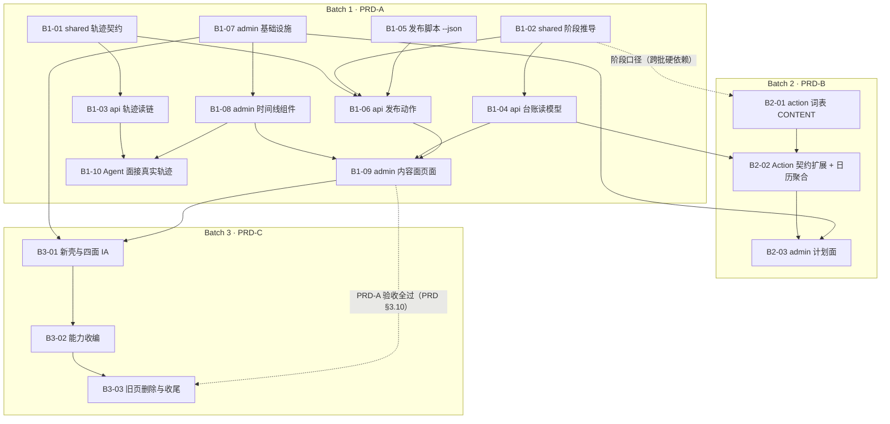

# 执行方案：内容运营后台（一人驾驶舱）

> **2026-09-22 执行入口替代**：本文是旧后台历史方案。此次重构使用 [to-do.md](to-do.md) 的 F/R/V/C/O/G 原子任务，优先级见 [PLAN.md](PLAN.md)。先完成框架 F01–F18；数据库只用 SQLite。不得按本文旧批次或旧完成记录执行新重构。

> **2026-09-21 后台重构状态（优先于下文旧界面说明）**：站主要求清空管理界面。`apps/admin` 仅保留空白开发/构建入口与 API 代理；计划、内容、复盘、设置、旧路由及管理 UI 均已退役。API、数据库、文章与共享规则保留，生产未部署此变更。旧后台页面图与验收记录仅作历史参考，不作为新重构需求。资产清单见 [后台重构前资产清单](docs/ADMIN-REBUILD-INVENTORY.md)。

## 0. 文档信息

| 字段 | 内容 |
|---|---|
| 名称 | 内容运营后台 · 执行方案（批次 + 任务分解 + 验证门禁） |
| 版本 | v1.0 |
| 日期 | 2026-09-15 |
| 上游权威 | 产品行为与验收以根 `PRD.md` 为准；**契约、分层、落点以 `TECH-DESIGN.md` v1.1 为准**（本文只引用、不复制契约内容） |
| 本文职责 | 只定义**顺序与批次**：做什么任务、谁先谁后、每批怎么算完成 |
| 硬约束 | **不含日历日期、不含工时估计**；与 TECH-DESIGN 冲突处以 TECH-DESIGN 为准 |

> **边界声明**：本文是执行方案。事件信封、端点契约、三条流的边界、安全清单等**契约性内容一律见 TECH-DESIGN**，本文不重复定义。
> 批次划分服从 `PRD.md §8`：先落 PRD-A 验收，B/C 随后。

---

## 1. 批次总览

| 批次 | 对应 PRD | 本批交付的用户可见价值 | 验收锚点 |
|---|---|---|---|
| **Batch 1** | PRD-A 内容运营闭环 | 站主**一个界面走完 草稿 → 审核 → 上线**：台账看清每篇卡在哪个阶段、详情页改稿保存、门禁面板告知缺什么、一键上线并如实看到结果，全程不开终端 | `PRD.md §3.6` A1–A14、`§3.7` 全部勾选 |
| **Batch 2** | PRD-B 计划面 | 打开一个面知道"今天/本周该做什么、该发什么"，能勾完成、改期、把「待上线」内容拖入发布日历 | `PRD.md §4.4` 全部勾选 |
| **Batch 3** | PRD-C 四面 IA 与旧页退役 | 新壳四面（内容/计划/Agent/系统）承载全部既有能力；旧路径重定向不 404、无白屏、无悬空引用 | `PRD.md §5.3` 全部勾选 |

---

## 2. Batch 1 · PRD-A 内容运营闭环

**本批交付的用户可见价值**：见 §1 表。验收锚点：`PRD.md §3.6` A1–A14 与 `§3.7` 验收清单。

### 任务列表（按实现顺序）

| 编号 | 标题 | 依赖 | 文件清单 | 完成判据（可验证） |
|---|---|---|---|---|
| B1-01 | shared 轨迹事件契约 | 无 | 新建 `packages/shared/src/trace.ts`、`packages/shared/src/trace.test.ts` | `pnpm test:shared` 覆盖：未知 type 容错、坏行降级 raw、缺 seq、旧事件（start/stage/done/error）兼容映射、v 不匹配分支（TECH-DESIGN §4.4） |
| B1-02 | shared 阶段推导（唯一实现） | 无 | 新建 `packages/shared/src/content-ledger.ts`、`content-ledger.test.ts` | 单测覆盖四阶段边界（`draft`/`review`/`ready`/`live`，含 `private`、缺字段、脏/干净工作区）；门禁字段复用 `PUBLISHED_POST_REQUIRED_FIELDS`，全库搜索无第二份清单（PRD A2） |
| B1-03 | api 轨迹读取链 | B1-01 | 新建 `apps/api/src/ports/trace.repository.ts`、`adapters/fs-trace.repository.ts`、`traces/trace.controller.ts`、`traces/trace.service.ts`；修改 `apps/api/src/kernel.module.ts` | `GET /runs/:runId/trace?after=<seq>&limit=<N>` 集成测：增量游标正确、默认尾部 500 行、旧格式文件可读；无全量解析（评审）（TECH-DESIGN §6.1–§6.3） |
| B1-04 | api 台账读模型 | B1-02 | 新建 `apps/api/src/ports/content-ledger.repository.ts`、`ports/git-status.repository.ts`、`adapters/fs-content-ledger.repository.ts`、`adapters/node-git-status.repository.ts`、`content-ledger/content-ledger.service.ts`、`content-ledger/content-ledger.controller.ts`；修改 `kernel.module.ts` | `GET /admin/content/ledger` 集成测：返回条数 = `content/log` 目录条目数（现 29）；评审确认 git 调用 O(1)（一次 status + 一次 HEAD，无逐文件 log）；**ledger 路由声明在 `:slug` 之前**（PRD A1/A3） |
| B1-05 | 发布脚本 `--json` 输出 | 无 | 修改 `scripts/content-publish.ts` | `--json` 输出含退出码/耗时/输出尾部；不带 flag 行为逐字节不变；提交边界与 push 行为不变（评审，TECH-DESIGN §0 影响面） |
| B1-06 | api 发布动作 | B1-01、B1-02、B1-05 | 新建 `apps/api/src/content-release/content-release.service.ts`、`content-release.controller.ts`；修改 `kernel.module.ts` | `POST /admin/content/release/preflight` 失败时断言工作区与 `content/log` 零变化（PRD A7）；`POST /admin/content/release` 并发两次→第二次返回"进行中"且只创建一个进程（PRD A9）；模拟非零退出→回显退出码与输出尾部（PRD A10）；spawn 参数全常量、无 shell（评审，PRD A8）；轨迹落 `kind:'publish'` 事件（D2） |
| B1-07 | admin 基础设施（Tailwind + token + hooks + api client） | 无 | 新建 `apps/admin/src/index.css`、`hooks/useAdminQuery.ts`、`hooks/useTrace.ts`；修改 `apps/admin/package.json`、`apps/admin/vite.config.ts`、`api/admin-api.ts`（增补 ledger/release/trace 方法） | `apps/admin` `tsc -b` 与 vitest 全绿；`--adm-*` token 只在 `@theme` 一处定义（TECH-DESIGN §7.3）；Tailwind v4 构建通过（D1） |
| B1-08 | admin 唯一时间线组件族 | B1-07 | 新建 `apps/admin/src/components/trace/TraceTimeline.tsx`、`TurnAudit.tsx`、`JsonlViewer.tsx`、`shared/labels.ts` | 组件测试覆盖三态：空态（真实空态文案，无假数据）、进行中（游标轮询）、失败（错误回显）；时间线渲染器只有这一个（TECH-DESIGN §7.2） |
| B1-09 | admin 内容面页面 | B1-04、B1-06、B1-08 | 新建 `apps/admin/src/pages/content/`（台账表格/看板、详情编辑、门禁面板、StageBadge、上线动作）；修改 `apps/admin/src/App.tsx`、`shared/routes.ts` | 走查 PRD `§3.7`：draft 不显示门禁缺口、缺 summary 恰好列 summary、补全后变「待上线」、上线成功变「已上线」、失败保持「待上线」且显示退出码+尾行；门禁口径与 `pnpm check:content-fields` 一致；390 宽完成"改稿→上线"（PRD A14） |
| B1-10 | Agent 面接真实轨迹 | B1-03、B1-08 | 修改 `apps/admin/src/pages/AgentWorkbenchPage.tsx` | 全库搜索 `TIMELINE_SEGMENTS` 与假 JSONL 样例为零（原 `:48-54`、`:801-804`）；前端契约无 `traceLogPath`，只用 `runId`（TECH-DESIGN §7.2/§8 #5） |

### 本批验证门禁

1. `pnpm typecheck`
2. `pnpm test:shared && pnpm test:api && pnpm test:web && pnpm test:agent`（AGENTS.md 验证链；本批未改 web/agent 也必须跑通确认零回归）
3. `apps/admin`：`tsc -b` + `vitest run`
4. 改了 `content/log` 先 `pnpm check:content-fields`（本批一般不涉及内容改动，但若测试夹具落内容则必跑）
5. 勾掉 `PRD.md §3.7` 全部 9 条验收标准

### 本批施工纪律重点（全表见 §5）

- **ledger 路由顺序**：`ledger` 声明必须在 `:slug` 之前（`:slug` 通配已在册，`content-admin.controller.ts:27-30`）。
- **先 port 后 adapter + 显式 `@Inject`**：B1-03/B1-04/B1-06 全部适用。
- **事件演进读在前写在后**：B1-01 词表与 `normalizeTraceEvent` 先于任何写入方落地。
- **payload ≤2000 字节、正文/密钥/绝对路径不进轨迹**（TECH-DESIGN §4.1、§8 #5）。
- **服务器路径不进前端契约**：B1-10 删 `traceLogPath` 渲染。
- **发布参数全常量、无 shell、preflight 零写、原子 check-and-set**（B1-06）。
- **删假样例**：B1-10，诚实原则（TECH-DESIGN §2 #4）。

### 本批回写清单

- `docs/api/README.md`：新增 `/admin/content/ledger`、`/admin/content/release/preflight`、`/admin/content/release` 与 `/runs/:runId/trace` 参数增补。
- `docs/ARCHITECTURE.md`：轨迹层与台账读模型补入图面。
- `docs/STATUS.md`：Batch 1 能力上线状态。

---

## 3. Batch 2 · PRD-B 计划面

**本批交付的用户可见价值**：见 §1 表。验收锚点：`PRD.md §4.4`。
**跨批硬依赖**：B1-02 的阶段口径（PRD §4.3：发布事实来自 PRD-A 的阶段，不复制独立状态）；B1-04 的台账读模型（日历聚合复用）。

### 任务列表

| 编号 | 标题 | 依赖 | 文件清单 | 完成判据（可验证） |
|---|---|---|---|---|
| B2-01 | action 词表加 `'CONTENT'` | B1-02 | 修改 `packages/shared/src/action.ts` | `pnpm typecheck` 绿；`entityType` 在 schema 是 `String?`（`schema.prisma:110`），**不触发任何 schema 变更**（TECH-DESIGN §9 B 行） |
| B2-02 | Action 契约扩展 + 发布日历聚合端点 | B2-01、B1-04 | 修改 `apps/api/src/action/action.service.ts`（create/update 接受 `entityType`/`entityId`，词表校验 fail-closed——现状硬编码 `null`，`:45-46`）、`action/action.controller.ts`；新建 `apps/api/src/plan/plan.controller.ts`、`plan.service.ts`；修改 `kernel.module.ts` | 集成测：创建 `entityType='CONTENT'` 排期→刷新仍在（PRD §4.4）；改期/删除排期断言 `content/log` 零变化；未知 entityType 直接 400；只加可选参数，旧调用方行为不变（TECH-DESIGN §10） |
| B2-03 | admin 计划面 | B2-02、B1-07 | 新建 `apps/admin/src/pages/plan/`（排期视图：今天/本周/未排期；发布日历：周/月粒度 + 今天锚点；未排期「待上线」拖入日期） | 走查 PRD `§4.4`：带日期任务出现在当天、勾完成可撤销、待上线内容拖入日期落为 Action 刷新仍在、逾期有视觉区分、删排期不动内容文件 |

### 本批验证门禁

1. `pnpm typecheck` → `pnpm test:shared && pnpm test:api`（+ test:web/test:agent 零回归）
2. `apps/admin`：`tsc -b` + `vitest run`
3. 勾掉 `PRD.md §4.4` 全部 5 条验收锚点

### 本批施工纪律重点

- **不复制阶段状态**：日历上的内容阶段一律实时读台账（B1-04），禁止落库缓存（PRD §4.3）。
- **entityType 词表校验 fail-closed**：与 `isFeatureKey` 同款范式（`observability.controller.ts:30`）。
- **排期是索引不是事实**：删排期断言传不动 `content/log`（PRD §4.4 末条）。

### 本批回写清单

- `docs/api/README.md`：Action create/update 契约扩展 + 日历聚合端点。
- `docs/PRODUCT.md`：计划面能力入册。
- `docs/STATUS.md`：Batch 2 状态。

---

## 4. Batch 3 · PRD-C 四面 IA 与旧页退役

**本批交付的用户可见价值**：见 §1 表。验收锚点：`PRD.md §5.3`。
**跨批硬依赖**：旧页删除必须等 PRD-A 全量验收通过（PRD §3.10）。

### 任务列表

| 编号 | 标题 | 依赖 | 文件清单 | 完成判据（可验证） |
|---|---|---|---|---|
| B3-01 | 新壳与四面 IA | B1-07、B1-09 | 修改 `apps/admin/src/AdminShell.tsx`（深墨侧栏、四面导航、可折叠系统组、命令面板）、`App.tsx`（新路由 + `LEGACY_REDIRECTS` 集中表）、`shared/routes.ts`、`shared/nav.ts`、`shared/labels.ts` | 四面（内容/计划/Agent/系统）可达且 ≤4 面（`docs/PRODUCT.md:22`）；全部跳转读 `ADMIN_ROUTES`，全库搜索无硬编码路径字符串（PRD 全局约束 6）；旧 `/content`、`/content/:slug` 命中重定向 |
| B3-02 | 能力收编 + 结构体检降级 | B3-01 | 迁移既有页入新壳：流水线/今日/工作台/线索/题苗/洞察/助手问题/执行/数/观测/AI 网关/智能体工坊/模型目录/技能包；`GraphHealthPage`、`CodeStructurePage` 降为系统面只读子页 | PRD `§5.2` 收编清单逐项走查全勾（功能等价，不许"以后再补"）；观测与 AI 网关保留 |
| B3-03 | 旧页删除与收尾 | B3-02，**且 Batch 1 验收全过**（PRD §3.10） | 删除被取代的旧 `pages/*.tsx`；清理 `styles.css`（token 已全部迁入 `@theme` 后） | 删页后 `pnpm typecheck` 与 admin 构建全绿、无悬空引用（收尾前 code-explorer 全量清点）；旧路径全部命中重定向或显式 404 页、无白屏；随时可经 git 回滚 |

### 本批验证门禁

1. `pnpm typecheck` → `pnpm test:shared && pnpm test:api && pnpm test:web && pnpm test:agent`
2. `apps/admin`：`tsc -b` + `vitest run` + `vite build`
3. 勾掉 `PRD.md §5.3` 全部 5 条验收锚点

### 本批施工纪律重点

- **重定向集中一处**：`LEGACY_REDIRECTS` 一张表，禁止散落各页（PRD §3.10）。
- **旧页最后删**：迁移期保留旧文件，保证随时回滚（PRD §3.10）。
- **不改被迁页面业务语义**（PRD §5.2 Out of Scope）。
- **不新增公开路由**：全部在 `/admin/*` 内，不动 `app.module.ts` exclude 表与 Caddyfile（TECH-DESIGN §3.3）。

### 本批回写清单

- `docs/ARCHITECTURE.md`：admin 四面结构图与读模型回写（TECH-DESIGN 附录 B 的明确要求）。
- `AGENTS.md`：管理端页面地图与新壳导航约定。
- `docs/STATUS.md`：Batch 3 状态与旧页退役记录。
- `docs/api/README.md`：如有端点归并说明。

---

## 5. 施工纪律总表（执行期红线，★ = 该批重点盯）

| # | 红线 | 出处 | B1 | B2 | B3 |
|---|---|---|---|---|---|
| 1 | 新能力先定 port 再写 adapter；DI 必须显式 `@Inject(TOKEN)` | TECH-DESIGN §3.3 | ★ | ★ | |
| 2 | controller 不带 `api/` 前缀；不新增公开路由、不动 exclude 表与 Caddyfile | TECH-DESIGN §3.3 | ★ | ★ | ★ |
| 3 | `/admin/content/ledger` 路由声明在 `:slug` 之前 | TECH-DESIGN §6.2 | ★ | | |
| 4 | 事件契约演进：读在前写在后；未知 type 容错；历史行永不迁移 | TECH-DESIGN §4.1/§10 | ★ | | |
| 5 | 轨迹 append-only；payload ≤2000B；禁放提示词/密钥/绝对路径 | TECH-DESIGN §4.1 | ★ | | |
| 6 | 服务器路径不进前端契约（只用 `runId`） | TECH-DESIGN §8 | ★ | | |
| 7 | 发布动作：唯一出口、参数全常量、无 shell、preflight 零写、原子 check-and-set、单实例锁 | TECH-DESIGN §5.2/§6.2 | ★ | | |
| 8 | 站主面无兜底如实抛错；访客面降级才走规则版，两条链不混 | TECH-DESIGN §5.4 | ★ | | |
| 9 | 删假样例、真实空态；API 不可达显错不装空列表（诚实原则） | TECH-DESIGN §7.2；PRD A13 | ★ | | ★ |
| 10 | 阶段推导唯一实现在 shared；门禁字段清单只有一份 | PRD A2；TECH-DESIGN §9 | ★ | ★ | |
| 11 | 不复制阶段状态；排期/轨迹都只是索引，真相源唯一 | PRD §4.3；TECH-DESIGN §1.1 | | ★ | |
| 12 | 重定向集中一张表；旧页最后删；随时可回滚 | PRD §3.10 | | | ★ |
| 13 | 页面路径全读 `ADMIN_ROUTES`，无硬编码 | PRD 全局约束 6 | ★ | | ★ |
| 14 | 密钥只出 last4；子进程输出不透传；模型推理不出前端 | TECH-DESIGN §8 | ★ | | |
| 15 | Prisma schema 零变更（无 db:generate、无迁移、生产不停服） | TECH-DESIGN §10 | ★ | ★ | ★ |

---

## 6. 待澄清 / 方案补充

以 TECH-DESIGN 为准的前提下，施工准备阶段发现以下方案缝隙，**均按 TECH-DESIGN 既有演进策略处置，不构成范围扩张**；若团队判定任一条超出契约表即全量的口径，须先回写 TECH-DESIGN 再施工对应任务：

| # | 事项 | 现状证据 | 建议处置 |
|---|---|---|---|
| Q1 | Action create/update 不支持 `entityType`/`entityId`（PRD-B 排期落库必需） | `action.service.ts:45-46` 硬编码 `null` | 已列为 B2-02：按 TECH-DESIGN §10「只加可选参数」扩展契约 + 词表校验；建议同步回写 TECH-DESIGN §6.2 端点表 |
| Q2 | 发布日历聚合端点（如 `GET /admin/plan/calendar`）未列入 TECH-DESIGN §6.2 端点契约表 | TECH-DESIGN §9 B 行只提词表 | 已列为 B2-02 一部分：按 §3.3 port-first 模式新增，路由在 `/admin/*` 防线内、不新增公开路由；建议回写 §6.2 增补该行 |
| Q3 | 「拖拽排期」交互实现方式 TECH-DESIGN 未指定 | PRD §4.2 要求拖入日期 | 建议零依赖自实现（HTML5 DnD），B2-03 施工时评审；不预引 dnd-kit 级依赖（Razor） |

---

## 附录：批次与 PRD 条款对照

| 批次 | 覆盖 PRD 条款 |
|---|---|
| Batch 1 | A1–A14（§3.6）、§3.7 验收 9 条、§3.8 失败态、全局约束 1/2/3/5/6/7 |
| Batch 2 | §4.2 In Scope、§4.3 关键约束、§4.4 验收 5 条 |
| Batch 3 | §5.2 In Scope、§5.3 验收 5 条、全局约束 4/6/8 |
