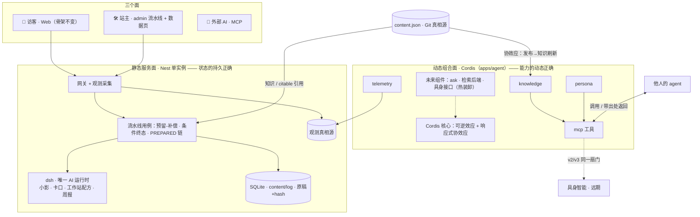

# PLAN.md — 主执行计划

> **2026-10-30 G07 生产部署完成与 admin 云端常驻**：生产环境执行完整发布，旧库无损平移 405 行至 `walker-v2.db`（27 迁移全量应用），`admin.iwalk.pro` 由盒子 Caddy 独立静态托管与 Let's Encrypt 证书常驻云端，API `e21b301` 在线。当前下一项为 G08（生产公共问答模型启用核验）。

> **2026-09-29 本地后台补项**：管理 API 增加独立请求日志与运营记录入口，Agent 未单独配置模型时继承系统默认。开发库迁移至 26 条；不计 G07/G08 完成，不部署生产。

> **2026-09-29 本地组件审查修复**：O05 转事项增加同事务幂等提交及审计唯一键；后台会话详情与首页小影修复状态文案、隐藏历史和键盘焦点。第 25 条 SQLite 迁移加入 G07 部署包，生产上线仍按 G07/G08 原门槛；证据见根 `to-do.md`。

> **2026-09-28 首页小影本地补项**：沿用原卡片首页，只把小影气泡贴近影鳐；新增全站公开位置并绑定后台已部署的小影模型，保留已核验快照、只读权限及 V23 readiness。开发库本地已启用且浏览器真答通过，生产上线仍走 G07/G08。证据见根 `to-do.md` 与 [本地验收](docs/evidence/LOCAL-HOME-XIAOYING-2026-09-28.md)。

> **2026-09-28 本地 UX 修订**：访客主导航收为“探索／文章／资源／关于”加独立“提问”入口；功能和路径不变，首页沿用原有四卡、Dora 卡居中。后台四主面不变，内容状态以线上确证事实为准；不改变 G07/G08 部署门槛。执行证据仍记根 `to-do.md`。

> **2026-09-27 审查修复插入项**：G07 前先完成七项本地发布/编辑边界修复及回归。发布单执行绑定当前批准版本，发布脚本和 API 共用持久锁，推送结果不明保留 `UNKNOWN`，连续内容更新必须能再次批准；不改变 G07/G08 的生产部署门槛。原子进度只记根 `to-do.md`。

> **2026-09-25 新后台方案入口**：[PRD](docs/specs/PRD-AGENT-OPERATIONS.md) + [开源调研](docs/specs/RESEARCH-AGENT-OPS-OPEN-SOURCE.md) + [技术方案](docs/specs/TECH-DESIGN-AGENT-OPERATIONS.md) + [原子任务 to-do.md](to-do.md)。按站主最新指令：框架优先，数据库统一 SQLite。F01–F18、R01–R33、V01–V24 与 C01–C05 已完成本地验收；下一项 C06，生产未部署。C02 持久化候选与发布事实；C03 实现文件 CAS；C04 实现候选 apply/reconcile 崩溃核对；C05 让人工保存经过管理鉴权、CAS 和 SQLite 审计，不再触发公共索引重建。候选原文读取、编辑 UI 和实际发布链仍待后续任务；V24 使用隔离数据库与假 Runtime 完成访客/日志闭环；当前真实 runtime 探针报告未配置，readiness 阻断公共位置启用。旧页面、旧批次完成记录与过去的验证时钟不代表新方案完成。

## 新后台重构实施顺序（2026-09-22，框架优先）

| 优先级 / 批次 | 工作范围 | 进入下一阶段的证据 | 状态 |
|---|---|---|---|
| P0 / F | 可运行框架：React/路由/鉴权/Refine、真实内容/Agent/历史运行只读、真实空态 | F18：可启动、可构建、可浏览真实资产；[本地验收](docs/evidence/ADMIN-FRAMEWORK-ACCEPTANCE.md) | 本地已验收，生产已部署 |
| P1 / R | Agent 基础：SQLite 迁移、不可变修订、事项授权、统一 Harness 执行、停止/恢复、后台试跑 | R24：创建→真实运行→记录→停止闭环；目标环境隔离探针；公共位置保持关闭 | R01–R33 本地已验收，生产已部署 |
| P2 / V | 访客服务：公开快照、位置绑定、只读问答、流式交付、文章入口、会话/交互/日志、保留、删除、受控导出、安全边界与启用前 readiness | V24：只读前台与日志全链可验；真实生产启用留 G08 | V01–V24 本地已验收，生产已部署（模型启用留 G08） |
| P2 / C | 内容闭环：人工编辑 CAS、独立候选、单次审批、发布清单、网页/索引核验 | C24：更新全链与故障恢复；人工编辑子集可按依赖提前 | C01–C24 本地已验收，生产已部署 |
| P2 / O | 运营闭环：单次提醒、问题转事项、关键数据、复盘→下一事项 | O10：完成一次可追溯运营回路；单次提醒可按依赖提前 | O01–O10 本地已验收，生产已部署 |
| P3 / G | 全链迁移、回归、资源验收、分步上线和生产核验 | G08：A01–A28 与实际部署结果；上线门槛不可跳过 | G01–G07 生产上线完成，下一项 G08 |

原 B0–B4 仅为上一版设计拆分，现由 F/R/V/C/O/G 替代。第一次交付限定 F01–F18；原子依赖、勾选与实录仅维护在 `to-do.md`，本表只维护优先级和里程碑。常规按 F→R→V→C→O→G 执行，允许按依赖提前交付人工编辑/提醒。

本次重构的具体边界优先于下文旧设计中的冲突表述：本地开发/隔离测试/现有生产统一 SQLite 独立文件，不使用 PostgreSQL、不维护双库；新增 Prisma 数据允许。AI 部件内交互采集属于已确认范围，全站点击流仍不做；前台 AI 永久只读，后台按事项授权，首期内容写入/发布走单次批准，持续全权内容委托留待后续。先保持一个模型运行槽，双槽另行实测与排期，不新增服务器或外部队列。以上是设计与执行决策，不表示生产配置已经变更。

> **2026-09-21 后台重构状态（优先于下文旧界面说明）**：站主要求清空管理界面。`apps/admin` 仅保留空白开发/构建入口与 API 代理；计划、内容、复盘、设置、旧路由及管理 UI 均已退役。API、数据库、文章与共享规则保留，生产未部署此变更。旧后台页面图与验收记录仅作历史参考，不作为新重构需求。资产清单见 [后台重构前资产清单](docs/evidence/ADMIN-REBUILD-INVENTORY.md)。

> 本文件是全项目的**主计划**：定顺序、定规则、定边界、记录想法。原子任务细节在三个执行清单里（见 §9 索引），本文件只管「先做什么、不做什么、为什么」。
> 建立于 2026-09-06（HEAD `1f80393` 部署验证后）。主线排期或宪法条款变更须回写本文件。

---

## 0. 北极星

- **原子**：站主被实践检验过的判断 × 真实他人的真实需要 = 一次相遇。其余一切（框架、运行时、面板）都是会通缩的生产资料；只有判断与信任升值。
- **心脏**：循环——信号 → 分析 → 选题 → 创作 → 审批 → 发布 → 回灌（知识与引用自动更新）。**至今转过 0 次。**
- **当前唯一优先**：让循环转过第一次。不是更多文章、不是更完善的系统，是一篇真实初稿走完全链并发布。
- **时钟**：验证盒 2026-09-03 起算 14 天，**9 月 17 日到期**。它度量真实使用，不度量系统完备度。

## 1. 五条宪法（改任何东西前先过这五条）

1. **真相源分工**：公开内容归 Git（content/log），过程数据归 SQLite，原稿归文件 + hash。三者可分存，状态定义必须一致可恢复。
2. **单实例**：一台盒子、一个 Nest、一个 dsh 常驻。无证据不引入第二实例、消息队列、外部监控栈、向量库。
3. **aiUsePolicy 是机器世界的权限宪法**：readable/citable/actionable 决定一切 AI 面（小影、卡口、判断代理、远期具身）能碰什么，无例外出口。
4. **诚实降级**：AI 可关；失败如实标注（aiUsedFlag / degradeReason）；引用必须带出处——对人和对机器调用方一视同仁。
5. **判断的定价权在人**：主选、审批、发布永远是站主的点击；AI 只起草和建议。

## 2. 架构边界（论文 arXiv:2608.25512 + 实测定案 · 完整图面见 [`docs/ARCHITECTURE.md`](./docs/ARCHITECTURE.md)）

**最终架构（定稿图）：**

- **两面**：
  - **静态服务面**（Nest，单实例）——状态的持久正确。业务层手工时间可组合性：配额预留-补偿、条件终态（setStatusUnless）、PREPARED→PUBLISHED 链。
  - **动态组合面**（Cordis，`apps/agent`）——能力的动态正确。可逆效应 + 反应式协效应；knowledge 插件对 content.json 声明协效应（发布→知识反应式刷新）；组件可热装卸不腐化状态。
- **三层中心规则**：进程内去中心（组件平等、无上帝对象）；机器间中心（一盒一份真相源）；访问层去中心（Web / llms.txt / MCP 开放协议——所有权集中、访问开放）。
- **骨架不换**：现有服务迁移 Cordis 已否决，不重议。Cordis 只以新建组合进入。

## 3. 主线排期（当前有效）

| # | 事项 | 谁 | 量级 | 验收锚点 | 状态 |
|---|---|---|---|---|---|
| 1 | 观测 P0：遥测代码级关闭 + dsh 会话 90 天清理脚本 | agent | 0.5d | TODO-OBSERVABILITY P0 三项 | ✅ 生产 |
| 2 | dsh 换工作站 AGENT_RUNNER + 集成测 | agent | 1d | 生产配方可跑；假 runner 全链测试过 | ✅ 生产（含两次根因修复，详见 TODO-MAINLINE M2 实录） |
| 3 | **★ 一篇真实初稿走完全链**（创建→加工→刷新审阅→批准→发布→线上验证） | **站主** | 站主 0.5d | 文章进 content/log，线上可访问，循环计数 0→1 | **心脏** |
| 4 | 共创文案三句 + 周报建议一键转题苗 | agent | 1d | 卡口/小影回执文案上线；建议可生成题苗草稿 | ✅ 生产 |
| 5 | admin 流水线视图（九页并五，流水线默认首页） | agent | 1–2d | 池→苗→作→品单视图可追踪 | ✅ 生产 |
| 6 | 判断代理 v1（apps/agent · Cordis · MCP） | agent | 1–2d | TODO-AGENT A0–A6；dogfooding 实录 | **A0–A3 ✅ A4 stub**（2026-09-06 提前解冻）；余 A5 dogfooding / A6 文档收尾 |
| 7 | 观测 P1（token/首字延迟/排队/降级原因落库） | agent | 1–2d | 线上真发一问，AssistantRun 新列有值 | 初稿后 |
| 8 | 验证盒复盘 | 站主+agent | 0.5d | **9 月 17 日**，拿真数据说话 | 已定日程 |
| 9 | **知识图谱**（Obsidian Graph View 逐条对齐 · 三面：访客 `/graph` + 站主体检 + MCP `neighbors`） | agent | ~5d（K1–K6） | `PRD-KNOWLEDGE-GRAPH.md` §9 全部验收 + `verify:geo` 过门禁 | **✅ K1–K6 建成**（2026-09-14 本地全绿；待盒子部署 + 线上验证） |
| 10 | **代码架构图谱**（同一个引擎、第二个领域 · 四面：门禁 `verify:architecture` + 访客 `/architecture` + admin 体检 + MCP 四工具） | agent | ~3d | `PRD-CODE-GRAPH.md` §9 全部验收（A1–A12）+ `verify:geo` / `verify:architecture` 双门禁 | **✅ 建成**（2026-09-15 本地全绿；admin 不做画布见 PRD D1） |

> **2026-09-06 优先级变更（站主指令）**：主线于 M2 完成后暂停（生产已一致运行 `44d026e`：dsh runner + 遥测关闭生效），**判断代理脚手架提前解冻并完成**（A0–A3 + A4 stub，详见 `docs/TODO-AGENT.md` 实录）。冻结条款对 M4/M5 维持；主线恢复点 = M3（站主初稿）。

分工一句话：**站主出判断和初稿，agent 出其余所有代码**；站主每天用自己的站一次——当第一个真实访客。

## 4. 冻结条款

> **2026-09-14 站主指令（改为「先达到，再验证」）**：冻结解除按目标架构对齐推进——观测 P1（`TODO-OBSERVABILITY` P1-1~P1-6）、数据页 P2（P2-1~P2-5）、判断代理接线（`TODO-AGENT` A4 接线 / A5 dogfooding / A6 文档）与 v2（A7）不再等「第一篇发布」，按清单顺序建成后再统一验证。**仍不因解冻而降级**：循环第一次转动（M3-2~M3-6）依旧是人的步骤与原唯一优先；「明确不做」（§5）与「不提前投入」（P3）不变。

- **第一篇发布前**：不启动判断代理编码、不接入任何新的基础设施想法。新想法只记账（§7），不排期。对站主和 agent 同等生效。（2026-09-14 起按上方指令解冻）
- 主线任何一步卡住超过 2 天 → 降级完成该步的最小版本继续推进，不允许用插入支线来回避。
- 理论（论文/框架/范式）不 override 实践：先让循环转过，组合面的语义才有数据可服务。

## 5. 明确不做（当前有效）

P2 数据页（等数据存在）、观测 P3 全部（按触发条件）、Cordis 迁移（已否决）、路由拆包、前端点击流、自建 PV、OTLP/外部监控栈、向量检索、分布式/多实例、微体站网络与点子社区（VISION 远格）。

## 6. 支线停车场（记账不排期）

| 支线 | 解冻触发 |
|---|---|
| 判断代理 v2（HTTP 公网 + ask 工具） | 外部真实用户或自用高频缺口 |
| session-stats 用户层挂载 | 网关折算不够（需 step 级细分） |
| token → 成本折算 | token 数据满一个月 |
| 洞察周报 token 采集 | 周报成为每周例行 |
| 工作站迁入 Cordis 组合面 | 工作站成为长驻编排器（热装卸真需求出现） |
| 具身 | 只保留写作习惯：方法论写成带步骤的行动指南 |

## 7. 想法记录（新想法先落这里，只记不排）

- 2026-09-14（站主会话）：**Obsidian 知识图谱**——先记账，当日即按站主指令（「完整功能排期」）转为正式立项，见 §3 第 9 项与 `docs/PRD-KNOWLEDGE-GRAPH.md`。
- 2026-09-15（站主会话）：**代码架构图谱**——「需要不同的知识图谱，有代码架构的知识图谱」。四问定调（第一用户 = agent 开发与监测 / 节点粒度与 Obsidian 一模一样 / 纯机器抽取 / 四形态全做），当日建成，见 §3 第 10 项与 `docs/PRD-CODE-GRAPH.md`。**未做**：admin 可拖拽画布（跨 app 无共享 UI 包，照搬即第二份引擎；正解是把引擎提成 `packages/graph-engine`，记账不排期）。

## 8. 状态快照（2026-09-06 · 主线 M1–M5 完成日）

- **已完成并部署**：T0–T4 优化批（`1f80393`）→ 观测 P0 + dsh 统一 runner（`44d026e`）→ 判断代理脚手架（`ec650c2`）→ 降级日志+api.log（`bbffd9c`）→ **M4 共创/转题苗 + M5 流水线 + 双合同超时修复（完成部署批次）**。
- **生产 AI 实况**：小影真答恢复（aiUsedFlag=true 实测）；卡口 nextStep 随完成部署恢复 AI（双合同超时根因已修：短调用 prompt 原样透传，A/B 探针 7.2s vs 45.8s）；工作站配方生产可用（dsh）。
- **生产事故记录（如实）**：09-06 部署中断引发半重启进程，助手+卡口一度规则兜底（窗口 14:50–23:15 UTC）；处置 = api.log 落盘 + 降级原因日志，复发可诊断。
- **主线状态**：M1✅ M2✅ M3-1✅（M3-2~4 待站主初稿——唯一剩余主线项）M4✅ M5✅；M6 判断代理 A0–A3✅A4stub；M8 复盘 9/17。
- **已备资产**：dsh 全历史 clone / pi clone / 参考仓库与 tarball（~/Desktop/agent-runtime-backup，含 MANIFEST）。
- **2026-09-09 智能体工坊全线交付**：后台智能体工坊与文件直调全线交付（PRD-AGENT-WORKBENCH.md v2.0）。实体智能体角色管理、小影 403 绝对保护、1:1 DSH 供应商模型池配置与 Ping 连通性探测、单次短命直调 `content/log/*.md` 跑完即焚与 120s 超时熔断保护、时序三色甘特图 100% 数据驱动、4 格硬核遥测账单、逐轮审计卡片与独立 `trace.jsonl` 管道（AES-256-GCM 强加密保护，全仓 77 个测试套件 323 项测试 100% 全绿）。
- **2026-09-14 知识图谱建成（K1–K6）**：Obsidian Graph View 逐条对齐版落地——访客 `/graph`（四组设置 + HTML 兜底过 GEO 门禁）、文章页局部图（Depth 1–5）、站主结构体检清单（admin `/graph` ← `GET /graph/health`）、机器面 MCP `neighbors`（aiUsePolicy fail-closed）。产物实测基线入档：**28 篇文章 / 19 条正文互引 / 14 篇孤岛（50%）/ 2 个坏链 / 61 个标签节点 / 2 个附件孤岛**；`PRD-KNOWLEDGE-GRAPH.md` §1.1 有全表。
- **2026-09-14 图谱引擎按源码重写（站主指令：先去 GitHub 找源码）**：从 `sim-original.js`（Obsidian 首页图谱的**原始 worker**）核对出三处实质错误并更正——力参数默认值实为 `0.1/1000/1/250`（原按帮助文档二手描述写成 `0.5/10`）、节点大小依据是**无向度数**而非入链数、`velocityDecay` 是 `×0.6` 直接相乘。补齐四叉树 Barnes–Hut（theta 0.9、distanceMin 30）、link 的 `bias` 分摊与逐边就地更新、collide（r 60/str .5）、初始布点算法、视口缓动与全部逐帧渲染公式；物理移入独立 Worker（单独成块 8.4KB）。自创的 `packages/shared/src/graph-layout.ts` 已删除（避免两套矛盾实现）。本地全链绿（typecheck + shared 106 + api 152 + agent 15 + web 167 + `verify:geo`）；**待盒子部署与线上验证**。已知既有文档漂移（非本次引入）：`docs/api/README.md` 被三处文档引用但文件不存在。
- **2026-09-14 图谱引擎逆向应用本体（站主指令：去找 Obsidian 的知识图谱长什么样、逆向）**：逐层剥离本机 `Obsidian.app/.../obsidian.asar`，定位应用图谱的设置面板、渲染器、节点、连线与配色（`app.js` / `app.css`），并确认**应用 worker 就是 `/sim.js`**（即此前提取的 `sim-original.js`，物理常数因此是应用级真值）。据此更正五处实质错误：`showTags` 默认**关**、Display 默认 `0/1/1`、斥力是「UI 10 立方 → 引擎 1000」、缩放夹取 `[1/128, 8]`、配色按类型语义化 11 键；补齐应用实测滑块区间、6 色槽分组与局部图方向开关。`PRD-KNOWLEDGE-GRAPH.md` v1.2（含 §0.1 真值层级、§2.3 配色表、偏离 D18–D22）。
- **2026-09-15 代码架构图谱建成**：同一个 Obsidian 对齐引擎的**第二个领域**（节点 = 源文件，边 = 真实 import）——抽取出 `packages/shared/src/code-{graph,resolve,imports,query,debt}.ts` + `scripts/lib/code-extract.ts`（`code:gen` 与门禁共用一份实现）；产物拆两份以隔离公开面（`codegraph.json` 给 web，`codegraph-health.json` 只给门禁/api/admin/agent）；门禁 `verify:architecture` 走**基线棘轮**（四条机器自证硬伤新增即失败；**不写人工规则文件**，理由是那会重述 `ARCHITECTURE.md`）；访客 `/architecture`（indexable + HTML 兜底 + 图例 + 选中详情）、admin `/architecture`（体检卡片 + 基线对账 + 明细表）、MCP 四工具（`dependencies` / `dependents` / `impact` / `architecture_health`）。实测基线入档：**430 个源文件 / 1101 条内部依赖边 / 0 环 / 1 个解析不到的引用 / 2 个从入口不可达 / 0 反向依赖**；风格项 6 个超大文件、10 个超级枢纽。生长动画由 13s 重标定为 3.3s（总时长优先）。`PRD-CODE-GRAPH.md` v1.0/v1.1（含偏离 D1–D12，其中 D1 = admin 不做画布）。**门禁首日即还债**（站主指令「删除」）：据体检删掉 5 个真死代码（`HeroSearchBar.tsx` / `useHomeCanvas.ts` / `packages/shared/src/content-load.ts` / `scripts/lib/env.ts` / `apps/api/src/database/database.module.ts`）+ 146 行死 CSS（`.hero-search*`，删前用「代码零引用 + DOM 命中 0 元素」双重确证）——门禁把它们报为「已还清」而不是报错，基线由 8 条收敛到 3 条（1 坏引用 + 2 手动脚本 `accept-real-works.ts` / `probe-production.ts`，两者在文档里被当作手动探针，故保留）；同时清掉 `packages/shared/dist` 里 `content-load.*` 与更早那次删除留下的 `graph-layout.*` 陈旧产物（否则 `@walker/shared/content-load` 在本地仍能解析）。全链绿：typecheck + shared 183 + api 158 + agent 25 + web 212 + `verify:geo` + `verify:architecture`。
- **循环计数**：完成并被检验的交付 = **0**（等站主初稿）；公开文章 28 篇；验证盒剩余 **8 天**。

## 9. 文档索引

| 文件 | 职责 |
|---|---|
| `docs/archive/PRD.md` | 旧后台内容运营 PRD（历史参考；新重构以 `docs/PRD-AGENT-OPERATIONS.md` 为准） |
| `docs/archive/TECH-DESIGN.md` | 旧后台技术方案（历史参考；新重构以 `docs/TECH-DESIGN-AGENT-OPERATIONS.md` 为准） |
| `docs/archive/EXEC-PLAN.md` | 旧后台 Batch 1–3 执行方案（历史参考；新重构唯一原子进度在根 `to-do.md`） |
| `docs/archive/TODO-MAINLINE.md` | 旧主线 M2/M3/M4/M5/M8 任务实录（历史参考；新重构唯一原子进度在根 `to-do.md`） |
| `docs/archive/TODO-AGENT.md` | 判断代理 v1 历史实录（A0–A7，四插件架构） |
| `docs/archive/PRD-AGENT-WORKBENCH.md` | 旧智能体工坊与模型设置 PRD（历史参考；新重构以 `docs/PRD-AGENT-OPERATIONS.md` 为准） |
| `docs/PRD-KNOWLEDGE-GRAPH.md` | 知识图谱 PRD（Obsidian Graph View 逐条对齐 · 图数据契约 · 偏离清单 · 三面验收） |
| `docs/STATUS.md` / `docs/ENGINEERING.md` / `docs/api/README.md` | 生产状态 / 工程事实 / API 契约 |
| `ops/windows/README.md` | 盒子运维：部署验证清单、备份恢复、runtime |
| `docs/PRD-SITE-ASSISTANT.md` | 站内助手 PRD 与技术决策 |
| `AGENTS.md` | 项目级 agent 指令与工程约定 |

已完成清单不在现行索引：`docs/archive/TODO-OPTIMIZATION.md`（T0–T4）、`docs/archive/TODO-SITE-ASSISTANT.md`（助手执行实录）。
