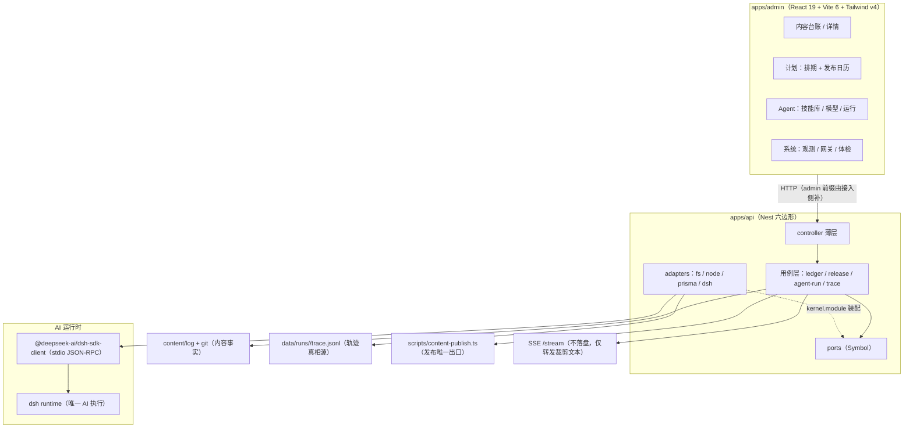

# 技术方案：内容运营后台 · AI 运行时与轨迹层

> **2026-09-22 文档适用范围**：本文保留为旧后台实现背景。此次 Agent 运营系统重构采用 [新技术方案](docs/TECH-DESIGN-AGENT-OPERATIONS.md)；下文“不改 Prisma schema”“DB 均由 trace 重建”等旧约束不适用于新方案。新方案尚未实施，不能据此宣称生产能力变更。

> **2026-09-21 后台重构状态（优先于下文旧界面说明）**：站主要求清空管理界面。`apps/admin` 仅保留空白开发/构建入口与 API 代理；计划、内容、复盘、设置、旧路由及管理 UI 均已退役。API、数据库、文章与共享规则保留，生产未部署此变更。旧后台页面图与验收记录仅作历史参考，不作为新重构需求。资产清单见 [后台重构前资产清单](docs/ADMIN-REBUILD-INVENTORY.md)。


## 0. 文档信息

| 字段 | 内容 |
|---|---|
| 名称 | 内容运营后台（一人驾驶舱）· AI 运行时与轨迹层技术方案 |
| 类型 | **技术方案**（运行时契约 + 分层边界 + 读取链路 + 前端设计） |
| 版本 | v1.1（v1.0 草稿经全量代码核验后定稿） |
| 日期 | 2026-09-15 |
| 影响面 | `apps/admin`（四面壳重建）、`apps/api`（轨迹读取 + 发布动作 + 读侧聚合）、`packages/shared`（事件契约与阶段推导）、`scripts/content-publish.ts`（加 `--json`，仅改 stdout 形态，**不动提交边界与 push 行为**） |
| 权威级别 | 实施权威。**产品行为与验收以根 `PRD.md` 为准**；本文只定义"怎么实现"。冲突时先改 PRD 再施工 |
| 明确不动 | Prisma schema（22 model 原样，`apps/api/prisma/schema.prisma`）、`content/log` 结构、既有写路径、`apps/agent` 的 MCP 工具面 |

> **本文边界声明**：本文是**技术方案**——只回答"用什么、怎么分层、契约长什么样、边界在哪、为什么这样取舍"。
> **排期、任务拆分、验收批次属执行方案**（由 PlanManager 管理），本文不重复、不复制、不与之并行定义第二套顺序。
> 若本文与执行方案冲突：**契约与边界以本文为准，顺序与批次以执行方案为准**。

### 0.1 待决项（已全部定案）

| # | 待决 | 结论 | 理由 |
|---|---|---|---|
| D1 | Tailwind v4 还是 3.4.17 | **v4** + `@tailwindcss/vite` | token 用 `@theme` 单文件定义，符合"样式 SSOT 只一处"；回退方案见 §1.2 |
| D2 | 发布动作是否也产 `trace.jsonl` | **是**：发布作为 `kind:'publish'` 的运行走同一写入器 | 「唯一时间线渲染器」的前提；上线事实时间线（PRD-A A11）与 Agent 运行事实同构 |
| D3 | `AssistantRun.traceId` 是否启用 | **启用但限定站主面**：字段语义 = `runId`（不存路径）；**访客面高频问答不写 trace 文件**（其业务真相已在 `AssistantRun` 表 + dsh 会话日志，见 §3.2），无轨迹的运行 `traceId` 保持 `null` 属如实而非缺陷 | 避免访客流量把 `data/runs` 吹爆；schema 已有该字段（`schema.prisma:209`），启用不触发 schema 变更 |

### 0.2 v1.0 → v1.1 修订记录（草稿核验结论）

草稿整体成立，以下条目经逐条打开文件核验后修正/补齐：

| # | 类型 | 内容 |
|---|---|---|
| R1 | 修正 | dsh 会话日志路径：`$DSH_HOME/sessions/*.jsonl.zstd` → 实际为**每会话一个目录** `session-*/session.jsonl.zstd`，prune 删整个目录（`ops/windows/prune-dsh-sessions.ps1:2-5, 11-13, 25-26`），见 §3.2 |
| R2 | 修正 | Vite 6 证据在 `apps/admin/package.json:25`（devDependencies `vite ^6.3.5`），`:13-19` 只覆盖 dependencies；草稿混为一处 |
| R3 | 修正 | `DeepSeekHarness` 构造中 `dshBin` 为**条件展开**（`harness-assistant.adapter.ts:94, 101`），草稿写成恒传参数 |
| R4 | 修正 | 常驻实例实现行号 `dsh-agent.runner.ts:68-95`（草稿 `:62-95` 把 `isShortCall` 判定也算入） |
| R5 | 修正 | `/agents/:id/runs` 端点证据应为 controller 层 `agent-unit.controller.ts:87-90`（草稿引的是 service 实现） |
| R6 | 补缺 | ledger 路由顺序约束的现实依据：既有 `@Get(':slug')` 已在 `content-admin.controller.ts:27-30`，新增 `ledger` 若同 controller 必须声明在前，见 §6.2 |
| R7 | 补缺 | A5「迟到响应保护」既有范式证据：`ContentEditPage.tsx:71-76`（`submitted` 比对），见 §9 |
| R8 | 补缺 | 管理端鉴权双防线（`AdminTokenMiddleware` + Caddy basic auth）入安全清单，见 §8 #11 |
| R9 | 定案 | D1/D2/D3 三个待决项全部给出结论（见 §0.1） |

---

## 1. 技术栈决议

| 层 | 选型 | 依据 / 现有事实 |
|---|---|---|
| AI 运行时 | **DeepSeek harness SDK**：`@deepseek-ai/dsh-sdk-client`（stdio JSON-RPC 驱动 dsh runtime） | 启动配方在 `apps/api/src/runtime/harness-launch.ts`：profile `sdk`、显式环境、只读工具 patch、`requestTimeoutMs: 60_000` |
| 轨迹 | **jsonl**：`data/runs/<runId>/trace.jsonl`，append-only | 已在用：`apps/api/src/agents/agent-runner.service.ts:332-341`（`createWriteStream(path,{flags:'a'})` + `writeEvent`） |
| 前端 | React 19 + TypeScript + **Vite 6** + `react-router-dom` 7 | 现状栈（`apps/admin/package.json:13-19` dependencies、`:25` `vite ^6.3.5`），**不降级** |
| 样式 / 组件 | **Tailwind v4** + shadcn/ui + `lucide-react` | 新增；D1 已定 v4 |
| 后端 | NestJS 六边形：`controller → service → ports(Symbol) ← adapters`，`kernel.module.ts` 唯一接线 | `docs/ARCHITECTURE.md:81-84`；`apps/api/src/kernel.module.ts` 现状即此风格 |
| 数据 | 不改 schema；轨迹不落库，库内只存**索引** | 见 §3.2 |

### 1.1 三个"唯一"（本方案的宪法级约定）

1. **唯一 AI 运行时 = dsh**。任何新 AI 能力必须经 `AgentRunnerPort` / `AssistantRunnerPort`，禁止在 service 里直连 HTTP 模型 API。
2. **唯一轨迹真相源 = `trace.jsonl`**。DB 的 `AgentRun` / `SkillRun` / `AssistantRun` 只是**索引与聚合**，其内容必须可由 jsonl 重建；**禁止用 DB 字段拼轨迹**（否则立刻双真相源）。
3. **唯一前端栈 = `apps/admin`**。不新建第二个管理应用。

### 1.2 D1：Tailwind 版本（已定 v4）

| 选项 | 优点 | 代价 |
|---|---|---|
| **v4** + `@tailwindcss/vite`（选定） | 无 postcss 配置；token 用 `@theme` 单文件定义，符合"样式 SSOT 只一处" | 插件版本需与 Vite 6 对齐；shadcn 初始化走 CSS-first 方式 |
| 3.4.17 + postcss + `tailwind.config.js` | 生态最稳、组件模板现成 | token 分散在 config 与 CSS 两处，与样式 SSOT 轻微冲突 |

**回退预案**：若构建期插件与 Vite 6 不兼容，退回 3.4.17，改动只落在 token 定义文件与构建配置，不影响任何业务代码与契约。

---

## 2. 现状（as-built）与差距

| # | 现状（有证据） | 差距 | 本方案处置 |
|---|---|---|---|
| 1 | 轨迹写入只覆盖 `runFile` 一条路径（`agent-runner.service.ts:332-341`）；助手 / 卡口 / 配方 / 发布不产 jsonl | 后台只有一个场景有轨迹，其余运行"只有索引没有正文" | §4 契约 + §5 让运行链共用同一写入器（发布含在内，D2） |
| 2 | 事件是**非版本化**的自由形状（`start`/`stage`/`done`/`error`，`:356-363`、`:381-392`、`:421-433`、`:484-490`、`:510-515`） | 加字段即隐性破坏读取方 | §4 引入 `v` + `seq` + 未知事件容错 |
| 3 | 读取是全量：`getRunTrace()` 读整文件 → `split('\n')` → 全量 `JSON.parse`，单行坏则降级 `{event:'raw',line}`（`:582-600`） | 长任务轨迹一大就全量进内存 + 全量过网 | §6 增量 `after=<seq>` + `tail=<N>` |
| 4 | 前端甘特图与 JSONL 查看器有**硬编码假样例**（`AgentWorkbenchPage.tsx:48-54` `TIMELINE_SEGMENTS`、`:801-804`） | 违反诚实原则：无数据时展示假轨迹 | §7 删除假样例，改真实空态 |
| 5 | `AgentRunResult` 把服务器绝对路径 `traceLogPath` 返回前端（`agent-runner.service.ts:67, 501`） | 路径是服务器实现细节，被固化进前端契约 | §8 前端契约只用 `runId` |
| 6 | `AssistantRun.traceId` 声明存在但恒为 `null`（`schema.prisma:209`、`assistant.service.ts:243`） | 助手回答无法关联轨迹 | §5.3 用 `runId` 打通，不新造字段语义（D3 限定站主面） |
| 7 | 降级词表已集中（`packages/shared/src/assistant.ts:22-31`） | 轨迹层没有对应的事件类型词表 | §4 词表同样进 shared |
| 8 | 站主面**无兜底、失败如实抛错**（`dsh-agent.runner.ts:12-13, 58`）；访客面才降级 | 两条链语义不同，易被后来的实现混同 | §5.4 表格固化差异 |
| 9 | 内容管理已有 `GET /admin/content`、`GET/PUT /admin/content/:slug`（`content-admin.controller.ts:15-35`），前端对应 `admin-api.ts:315-324` | `:slug` 通配已在册，新增 `ledger` 等固定段有**被通配吃掉**的现实风险 | §6.2 路由注册顺序约束 |

---

## 3. 分层与边界

### 3.1 组件图



### 3.2 三条"流"的边界（不澄清这条，后面必然乱）

| 流 | 位置 | 谁写 | 是否权威 | 用途 |
|---|---|---|---|---|
| **dsh 会话日志** | `$DSH_HOME/sessions/session-*/session.jsonl.zstd`（**每会话一个目录**，`prune-dsh-sessions.ps1:2-5`） | **dsh runtime 自己**（`docs/PRD-SITE-ASSISTANT.md:137`） | **否**：runtime 缓存，默认 90 天 prune 整个 `session-*` 目录（`prune-dsh-sessions.ps1:11-13, 25-26`） | 仅 dsh 内部续轮；本仓库**不读、不解析** |
| **运行轨迹** | `data/runs/<runId>/trace.jsonl` | 本仓库（唯一写入器） | **是**：append-only，永不改写、永不删行 | 后台一切"事实时间线"的唯一来源 |
| **SSE 流** | 内存 | adapter | 否 | 访客面流式回显；**只出裁剪后文本**，与轨迹无关 |

**推论**：后台要展示的一切运行事实，必须能在 `trace.jsonl` 里找到；找不到的一律不展示。

### 3.3 依赖方向与接线纪律

- 依赖方向不变：`controller → service → port ← adapter`；新增能力**先定 port 再写 adapter**。
- **DI 必须显式**：`@Inject(TRACE_REPOSITORY)`；裸接口参数在 `tsx` 下会注入 `undefined`（`docs/ARCHITECTURE.md:82`；`agent-runner.service.ts:74-77` 有同款注释）。
- controller **一律不自带 `api/` 前缀**：生产 Caddy `handle_path` 与开发 vite rewrite 都会剥掉 `/api`（`docs/ARCHITECTURE.md:69`）。
- 新端点全在 `/admin/*` 与既有 `/runs` 下，**不新增公开路由**：因此**不改** `apps/api/src/app.module.ts` 的 exclude 表（`:20-30`），也**不动** `ops/windows/Caddyfile`。`/admin/*` 与 `/runs` 默认已在 `AdminTokenMiddleware` 防线内。

---

## 4. jsonl 事件契约 v1（本方案核心）

### 4.1 通用信封

```jsonc
{
  "v": 1,                    // 契约版本，读取方按版本分支
  "seq": 12,                 // 单调递增，从 1 开始；读取方以它做增量游标
  "ts": 1750000000123,       // 事件发生时刻（ms）
  "runId": "run_1750000000000_ab12cd34",
  "type": "stage.end",       // 词表见 4.2
  "source": "api",           // api | dsh | publish —— 谁产生的这条事实
  "payload": { }             // 类型专属
}
```

**四条纪律**

1. **只追加**：永不 rewrite、永不删行、永不改历史行。修正用新事件表达（`run.amended`），不改旧行。
2. **读取方容错**：未知 `type` 保留原文不崩；解析失败的行降级为 `{ type:'raw', line }`（沿用 `agent-runner.service.ts:593-598` 既有范式）。
3. **词表唯一**：类型常量与 payload 类型定义放 `packages/shared`，api 与 admin 共用一份（对齐 `assistant.ts:22-31` 的降级词表做法）。
4. **正文不进轨迹**：payload 禁止放完整提示词、密钥、绝对路径。`AgentRun.promptSnapshot` 是索引侧调试锚点；轨迹里只留 `promptChars` 这类度量。

### 4.2 事件类型词表（v1）

| type | 触发 | payload 必填 | 消费者 |
|---|---|---|---|
| `run.start` | 运行开始 | `kind: 'agent'\|'assistant'\|'publish'`、`agentId?`、`target?` | 时间线 |
| `stage.start` | 阶段开始 | `stage: 'input'\|'model'\|'tool'\|'persist'`、`label` | 甘特图 |
| `stage.end` | 阶段结束 | `stage`、`elapsedMs`、`data`（各阶段自有度量） | 甘特图 + 四格指标 |
| `model.usage` | 模型回执到达 | `model`、`promptTokens`、`completionTokens`、`cacheHitTokens` | 缓存命中率与账单 |
| `tool.call` | 工具调用 | `tool`、`paramsHash`（**哈希，不是原文**） | 逐轮审计 |
| `tool.result` | 工具返回 | `tool`、`ok`、`outputBytes` | 逐轮审计 |
| `gate.check` | 门禁校验（内容上线） | `gate: 'published-fields'\|'geo'`、`ok`、`missing[]` | 内容详情门禁面板 |
| `run.end` | 运行结束 | `status: 'SUCCESS'\|'FAILED'`、`elapsedMs`、`metrics` | 索引与列表 |
| `run.error` | 运行失败 | `status:'FAILED'`、`code`、`message`（**截断**）、`exitCode?` | 失败回显 |
| `raw` | 读取侧兜底 | `line` | 查看器 |

### 4.3 与现状的兼容映射

历史行**不改写、不迁移**（这正是 append-only 的收益），读侧统一经纯函数适配：

| 旧事件 | 规范化为 |
|---|---|
| `start` | `run.start` |
| `stage{stage:'input'\|'model'}` | `stage.end` |
| `done` | `run.end` |
| `error` | `run.error` |

适配函数 `normalizeTraceEvent(input)` 放 `packages/shared/src/trace.ts`，api 与 admin 共用。

### 4.4 落点

```
packages/shared/src/
├── trace.ts            # [NEW] 信封 / 类型 / 词表 / normalizeTraceEvent / parseTraceLine（纯函数）
└── trace.test.ts       # [NEW] 边界：未知 type、坏行、缺 seq、旧事件兼容、v 不匹配
```

---

## 5. 执行模型（运行时语义）

### 5.1 两种运行时形态（沿用现状判据，不重造）

| 形态 | 判据 | 实现 |
|---|---|---|
| 常驻实例 | `timeoutMs <= DSH_SHORT_CALL_MS(60s)` | `DshAgentRunner.runResident()`（`dsh-agent.runner.ts:68-95`）：`shortLock` 串行；超时 / 取消**不丢**实例，仅传输故障重建（`:81-90`） |
| 独立实例 | 长任务（配方 / 发布） | `runIsolated()`（`:98-108`）：每次 `factory()` 新实例，`finally` 关闭 |

**超时预算**：阶段上限 10 分钟（`dsh-agent.runner.ts:24-25`）；短调用阈值 60s（`:27-28`）；助手问答 15s（`harness-assistant.adapter.ts:40-43`）；直调 120s（`agent-runner.service.ts:325`）。新增运行类型**必须显式声明预算**，禁止靠默认值。

### 5.2 并发与互斥（复刻既有原子范式）

- **原子 check-and-set**：在任何 `await` 之前完成注册（`apps/api/src/workflow/production.service.ts:37-40`；`finally` 释放在 `:117-119`）；重复触发抛 `already-running`，前端显示"进行中"。
- **终态保护**：用 `setStatusUnless` 语义（`ports/work.repository.ts:50-54` + `adapters/prisma-work.repository.ts:96-104`），迟到结果不得覆盖 `CANCELLED` 等终态。
- **发布动作**：进程内单实例锁 + 超时；子进程 **不 detached**（需退出码与输出）。

### 5.3 助手链与轨迹打通（D3 定案）

助手当前不产轨迹（`AssistantRun.traceId` 恒 `null`，`assistant.service.ts:243`）。处置：**不新增字段语义**，`traceId` 定义为 `runId`（**不存路径**）。写入范围限定**站主面发起的运行**（Agent 直调 / 配方 / 发布）走同一 `trace.jsonl` 写入器；**访客面高频问答不写 trace 文件**——其业务真相已在 `AssistantRun` 索引表（含 token / 降级原因，`assistant.service.ts:235-252`）与 dsh 会话日志（§3.2），再产一份 jsonl 只会放大 `data/runs` 体量且制造第三真相源。无轨迹的运行 `traceId` 保持 `null`，如实。

### 5.4 失败语义（两条链必须分清）

| 面 | AI 不可用 / 失败时 | 依据 |
|---|---|---|
| 访客面（小影、卡口 nextStep） | **降级到规则版**，回答仍非空，`aiUsedFlag` 如实标注 | `harness-assistant.adapter.ts:175, 336-342`；`rule-assistant.adapter.ts:47` |
| **站主面（Agent 面、配方、发布）** | **不兜底，如实抛错**；错误码映射到 HTTP | `dsh-agent.runner.ts:12-13, 58` |

两者都必须在轨迹留痕：降级写 `run.error{code:'ai-disabled'}`，**绝不写成功**。

---

## 6. 读取链路与接口契约

### 6.1 端口与适配器落点

```
apps/api/src/
├── ports/trace.repository.ts          # [NEW] TraceRepositoryPort + TRACE_REPOSITORY
├── adapters/fs-trace.repository.ts     # [NEW] 按 seq 游标增量读 / 尾部 N 行；复用 shared parseTraceLine
├── traces/trace.controller.ts          # [NEW] 读端点（薄层）
├── traces/trace.service.ts             # [NEW] 聚合：索引表 + 轨迹，供 Agent 面与内容面共用
└── kernel.module.ts                    # [MODIFY] 显式 @Inject 接线
```

### 6.2 端点契约

| 端点 | 方法 | 说明 | 变更 |
|---|---|---|---|
| `/runs/:runId/trace` | GET | 保留（`agent-unit.controller.ts:92-95`）；**增补** `?after=<seq>&limit=<N>`，默认尾部 500 行 | 修改，向后兼容 |
| `/runs/:runId` | GET | 运行索引 + 度量（**不含服务器路径**） | 修改 |
| `/agents/:id/runs` | GET | 保留（`agent-unit.controller.ts:87-90`，service 实现 `agent-runner.service.ts:573-579`，take 20） | 不变 |
| `/admin/ai/stats` | GET | 保留（`observability.controller.ts:71-74`） | 不变 |
| `/admin/content/ledger` | GET | 台账读模型 | 新增（**必须注册在 `/admin/content/:slug` 之前**——`:slug` 通配已在册，`content-admin.controller.ts:27-30`，声明顺序错误会被通配吃掉） |
| `/admin/content/release/preflight` | POST | 门禁预检，返回 `missing[]`，**无写动作** | 新增 |
| `/admin/content/release` | POST | 触发上线，返回 `{ runId, status }` | 新增 |

### 6.3 性能纪律

- 轨迹读取**禁止全量解析**（现状 `agent-runner.service.ts:582-600` 是全量）；默认只读尾部 N 行，大文件用游标续读。
- 台账列表的 git 调用 **O(1)**：一次 `git status --porcelain -z -- content/log` + 一次 `git log -1 --format=%H`；禁止逐文件 `git log`（`content/log` 现 29 条，逐文件查询会线性放大进程 spawn）。
- 内容读盘 29 篇直接读，不加缓存（YAGNI）；超 ~200 篇再评估 mtime 记忆化。
- 事件 `props` 上限 2000 字节（`observability.controller.ts:17-18, 46-48`）——轨迹 payload 沿用同一上限。

---

## 7. 前端设计

### 7.1 落点

```
apps/admin/src/
├── index.css                        # [NEW] Tailwind 入口 + @theme（--adm-* token 唯一映射处）
├── App.tsx                          # [MODIFY] 新路由 + LEGACY_REDIRECTS 集中表
├── AdminShell.tsx                   # [MODIFY] 深墨侧栏、四面导航、折叠系统组、命令面板
├── shared/routes.ts | nav.ts        # [MODIFY] 四面 IA；跳转一律读 ADMIN_ROUTES
├── shared/labels.ts                 # [NEW] 阶段 / 分组 / 文案唯一来源
├── hooks/useAdminQuery.ts           # [NEW] 读请求：loading/error/refetch/去重（与 useAdminAction 同族）
├── hooks/useTrace.ts                # [NEW] 轨迹读取：游标 `seq` 续拉，运行中才轮询
├── components/trace/TraceTimeline.tsx   # [NEW] 唯一时间线渲染器（内容上线 + Agent 运行共用）
├── components/trace/TurnAudit.tsx       # [NEW] 逐轮审计（tool.call / tool.result）
└── components/trace/JsonlViewer.tsx     # [INLINE→NEW] 抽自 AgentWorkbenchPage:771-807，**删假样例**
```

### 7.2 关键前端决策

| 决策 | 选择 | 理由 |
|---|---|---|
| 轨迹实时性 | **轮询（1–2s）**，不做 SSE | 站主面运行是低频重操作；SSE 现状只服务访客问答（`assistant.controller.ts:58-104`），引第二条流增加无谓复杂度 |
| 时间线渲染器 | **只做一个**，内容上线与 Agent 运行共用 | 两者事实同构（阶段 + 度量 + 终态）；两个渲染器必然漂移（D2 是其前提） |
| 数据获取 | `useAdminQuery` + `useAdminAction` | 仓库既有约定是 `useAdminAction`（`apps/admin/src/hooks/useAdminAction.ts`）；引 React Query 会形成双模式 |
| 空态 | **真实空态文案** | `TIMELINE_SEGMENTS`（`AgentWorkbenchPage.tsx:48-54`）与假 JSONL（`:801-804`）必须删除 |
| 路径 | 只用 `runId`，不接收 `traceLogPath` | 服务器路径不进前端契约（§8） |
| 响应式 | ≥1280 三栏 / 1024–1280 图标条 / <1024 顶部标签 + 单列 | 与 PRD-A A14 验收一致 |

### 7.3 视觉 token

现有 `--adm-*` 变量（`apps/admin/src/styles.css`，200+ 处引用）收敛进 Tailwind `@theme` 一处；`styles.css` 在旧页迁完后删除。`apps/admin` 现 dependencies 只有 `@walker/shared` / React / Router / lucide（`apps/admin/package.json:13-19`），新增 `tailwind` / `shadcn` / `clsx` / `tailwind-merge` / `sonner` 一次装齐。

---

## 8. 安全与诚实（不可破清单）

| # | 规则 | 依据 |
|---|---|---|
| 1 | 模型内部推理**不出前端**（只处理 `text-delta`） | `harness-assistant.adapter.ts:250-252`、`:160-162` |
| 2 | 原始模型 JSON（含 citations）不外发；只出 `extractStreamedAnswer` 裁剪文本 | 同文件 `:225-227`、`:255-260` |
| 3 | 子进程 stdout / stderr **不透传**（防 key / 路径泄漏） | `docs/PRD-SITE-ASSISTANT.md:139` |
| 4 | 密钥只出 `last4`，`****` 不回流明文 | `schema.prisma:270`、`AgentWorkbenchPage.tsx:1204-1206` |
| 5 | 轨迹 payload 禁放完整提示词 / 密钥 / 绝对路径 | §4.1 |
| 6 | 访客问答遥测**默认关**，不经 OTLP 出网 | `apps/api/src/runtime/harness-launch.ts`：未设 `DSH_TELEMETRY_ENABLED_OVERRIDE` 时子进程带 `DSH_TELEMETRY_DISABLED=1` |
| 7 | `aiUsePolicy` fail-closed：`readable && citable` 才可引用；60k 字符上限 | `fs-site-content-index.ts:74-81, 106-117`（上限常量 `:15`） |
| 8 | 文件写盘路径必须限定 `content/log/`，否则 403 | `agent-runner.service.ts:112-132` |
| 9 | `aiUsedFlag` 如实标注（AI 成功 true / 规则兜底 false） | `harness-assistant.adapter.ts:318`、`rule-assistant.adapter.ts:47` |
| 10 | 日志只落尾 N 行；台账构建只记条数与耗时，不打印正文 | §6.3 |
| 11 | 管理端**双防线**不削弱：`AdminTokenMiddleware`（`app.module.ts:16-32`，exclude 表之外全要凭据）+ Caddy basic auth（AGENTS.md「管理凭据体系」）；新端点一律落在防线内 | `apps/api/src/app.module.ts`、`AGENTS.md` |

---

## 9. PRD 追溯映射

| PRD 条目 | 技术落点 | 验证方式 |
|---|---|---|
| A1 台账聚合 | `ContentLedgerService` + `ports/content-ledger.repository.ts` | API 集成测：返回条数 = 目录条目数（现 29） |
| A2 阶段单源 | `packages/shared/src/content-ledger.ts` `deriveContentStage`（复用 `content.ts:14-22` 字段清单与 `:27-34` 判空、`:60-69` 可见性） | 全库搜索确认无第二处推导 |
| A3 git O(1) | `ports/git-status.repository.ts` + node adapter | 评审 + 内容量翻倍耗时对比 |
| A4–A5 编辑与保存 | 既有 `ContentAdminService` save（`content-admin.controller.ts:32-35`）+ 前端 `submitted` 比对范式（`ContentEditPage.tsx:71-76`） | 落盘字节断言 + 比对回归测 |
| A6 门禁面板 | `missingPublishedPostFields`（`packages/shared/src/content.ts:27-34`） | 缺 3 项 → 恰好列 3 项 |
| A7 上线前预检 | `/admin/content/release/preflight` | 断言工作区与 `content/log` 零变化 |
| A8 唯一出口 | `ContentReleaseService` spawn `scripts/content-publish.ts`，常量参数、无 shell | 评审：无外部文本插值 |
| A9 串行互斥 | 原子 check-and-set（范式：`production.service.ts:37-40`）+ 单实例锁 | 并发两次 → 第二次 running，仅一个进程 |
| A10 失败回显 | `run.error` 事件 + 退出码 | 模拟非零退出 → 界面显尾行 + 退出码 |
| A11 事实时间线 | `trace.jsonl`（含 `kind:'publish'`，D2）+ `TraceTimeline` | 三类事实来源标签正确 |
| A12–A14 交互与响应式 | `StageBadge`（判据文案与 PRD §3.4 逐字一致）/ Tailwind 断点 | 390 宽走通改稿 → 上线 |
| B 计划面 | `Action` 复用（`schema.prisma:105-122`：`plannedDate` / `entityType` / `entityId` + `@@index([entityType, entityId])`），词表加 `'CONTENT'`（`packages/shared/src/action.ts:7-13`；`entityType` 是 `String?`，**不触发 schema 变更**） | 排期落库、刷新仍在 |
| C 四面迁移 | 新壳 + `LEGACY_REDIRECTS`；路径全读 `ADMIN_ROUTES`（`shared/routes.ts`） | 旧路径无白屏；删旧页后 typecheck 全绿 |

---

## 10. 兼容与契约演进策略

| 场景 | 策略 |
|---|---|
| 事件加字段 | 加在 `payload` 内，`v` 不变；读取方必须忽略未知字段 |
| 事件语义变更 | `v` 递增；读取方按 `v` 分支，历史文件永不需要迁移 |
| 新增事件类型 | 先加词表与读取方容错，再加写入方（**读在前，写在后**，避免旧前端遇未知类型崩） |
| 端点加参数 | 只加可选参数；`?after/limit` 缺省时保持现状行为（尾部 N 行） |
| 前端契约变更 | 一次性完成（无外部消费者）；但**服务器路径类字段禁止进入契约** |
| 旧页退役 | 迁移期一律重定向，重定向表集中一处；删除只在收尾进行，随时可回滚 |
| Prisma schema | 本方案**不触发**任何 schema 变更：无 `db:generate`、无迁移、生产无需停服 |

---

## 11. 风险

| 风险 | 缓解 |
|---|---|
| 事件契约引入 `v` / `seq` 后旧文件读取回归 | 读侧统一走 `normalizeTraceEvent`（shared），旧文件不迁移；专门加兼容测试 |
| 发布接入同一写入器后轨迹文件数增长 | 目录按 `runId` 隔离（已如此）；运维 prune 只清 `$DSH_HOME/sessions`（runtime 缓存），**不动** `data/runs`；访客面问答不写轨迹（D3）控制体量 |
| Tailwind v4 与 Vite 6 插件版本对齐问题 | D1 回退预案；退回 3.4.17 只影响 token 文件与构建配置，不影响业务代码与契约 |
| 旧页退役引发悬空引用 | 收尾前用 code-explorer 全量清点引用；旧页最后删 |
| `/admin/content/ledger` 被 `:slug` 通配吃掉 | 路由声明顺序约束写入 §6.2 并在 code review 清单固化 |

---

## 12. 不做清单（Non-goals）

- 不改 Prisma schema、不做数据库迁移、不需要生产停服换引擎。
- 不做服务端多轮会话存储（对话历史仅前端 state，对齐 `docs/PLAN-AGENT-MANAGEMENT.md` §8 `:229-241`）。
- 不做轨迹的数据库化 / 索引化（jsonl 即真相）；不引 OTel / ClickHouse 级 trace 平台。
- 不做 SSE 推流给后台（轮询足够）。
- 不把 `apps/agent` 的 MCP 工具面纳入本方案（它是给外部 agent 的，不是后台运行时）。
- 不引 React Query / 状态管理库；不新建第二个前端应用。
- 不做定时发布、提醒推送、多作者权限体系。
- 不给访客面问答写 trace.jsonl（D3 定案，见 §5.3）。
- **不在本文定义排期与任务批次**（属执行方案）。

---

## 附录 A：事实清单（可溯源）

| 事实 | 位置 |
|---|---|
| DSH SDK 导入与启动 | `apps/api/src/runtime/harness-launch.ts` |
| DSH 实例构造与 cwd / env 约束 | 同上：环境白名单、`WALKER_DSH_RUNTIME_BIN`、前后台 `DSH_HOME`、工作区 `materials` |
| 助手超时 / 队列 / 降级 | 同上 `:40-43`、`:46`、`:175-204`、`:281-312`、`:325-342` |
| 站主面无兜底 | `apps/api/src/adapters/dsh-agent.runner.ts:12-13, 58` |
| 常驻 / 独立形态与短锁 | 同上 `:24-28`、`:68-95`、`:98-108` |
| 轨迹写入（唯一） | `apps/api/src/agents/agent-runner.service.ts:332-341`、`:356-363`、`:381-392`、`:421-433`、`:484-490`、`:510-515`、`:532-535` |
| 轨迹读取（全量，待改） | 同上 `:582-600`（raw 兜底 `:593-598`） |
| 服务器路径出前端 | 同上 `:67, 501`（`traceLogPath`） |
| 路径安全（限 `content/log/`） | 同上 `:112-132` |
| 运行索引写入点 | 同上 `:437-456`、`:550-566` |
| 目录约定（`skills/<id>/`） | `apps/api/src/skills/skill.service.ts`（list / selfcheck / export / run） |
| 运行互斥原子范式 | `apps/api/src/workflow/production.service.ts:22-23, 37-40, 117-119` |
| 条件终态写 | `apps/api/src/ports/work.repository.ts:50-54`、`adapters/prisma-work.repository.ts:96-104` |
| 审批按 hash | `apps/api/src/workflow/review.service.ts:45-53` |
| `aiUsePolicy` 边界 | `apps/api/src/adapters/fs-site-content-index.ts:74-81, 106-117`（60k 上限 `:15`） |
| 降级词表（唯一） | `packages/shared/src/assistant.ts:22-31` |
| 事件 props 上限 | `apps/api/src/observability/observability.controller.ts:17-18, 46-48` |
| 助手 SSE 事件面 | `apps/api/src/assistant/assistant.controller.ts:58-104` |
| 内容管理现状端点 | `apps/api/src/content-admin/content-admin.controller.ts:15-35`（`:slug` 通配在 `:27-30`） |
| A5 迟到响应保护范式 | `apps/admin/src/pages/ContentEditPage.tsx:71-76` |
| admin 现有依赖 | `apps/admin/package.json:13-19`（deps）、`:25`（vite ^6.3.5） |
| 假样例数据（待删） | `apps/admin/src/pages/AgentWorkbenchPage.tsx:48-54, 801-804` |
| 路由 / 导航 SSOT | `apps/admin/src/shared/routes.ts`、`apps/admin/src/shared/nav.ts` |
| 内容契约（可见性 / 必需字段 / 判空） | `packages/shared/src/content.ts:6, 14-22, 27-34, 60-69` |
| Action 复用基础（PRD-B） | `apps/api/prisma/schema.prisma:105-122`；词表 `packages/shared/src/action.ts:7-13` |
| 管理端鉴权 | `apps/api/src/app.module.ts:16-32`（exclude 表）+ Caddy basic auth |
| dsh 会话日志形态与 prune | `ops/windows/prune-dsh-sessions.ps1:2-5, 11-13, 25-26` |
| 分层与 DI 纪律 | `docs/ARCHITECTURE.md:81-84` |
| 挂载前缀约定 | 同上 `:69` |
| 一人可养 ≤4 面 | `docs/PRODUCT.md:22` |

## 附录 B：与其他文档的关系

| 文档 | 关系 |
|---|---|
| `PRD.md` | 产品行为与验收的权威；本文服从 |
| 执行方案（PlanManager） | 顺序与批次权威；本文不定义排期 |
| `docs/ARCHITECTURE.md` | 全局架构唯一图面；本方案落地后须回写 admin 结构图与读模型 |
| `docs/PRD-AGENT-WORKBENCH.md` | 智能体工坊产品定义；本文的 Agent 面设计不改其产品定位 |
| `docs/PLAN-AGENT-MANAGEMENT.md` | Agent 管理系统技术方案（技能资产三层）；两者在 `/agents` 收编处交汇，冲突时须先合并结论再施工 |
| `docs/PRD-SITE-ASSISTANT.md` | 助手链路产品定义；本文 §5.3 打通轨迹属实现细节，不改其产品行为 |
