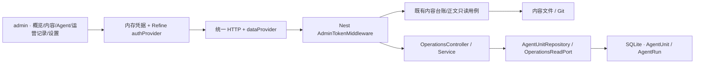
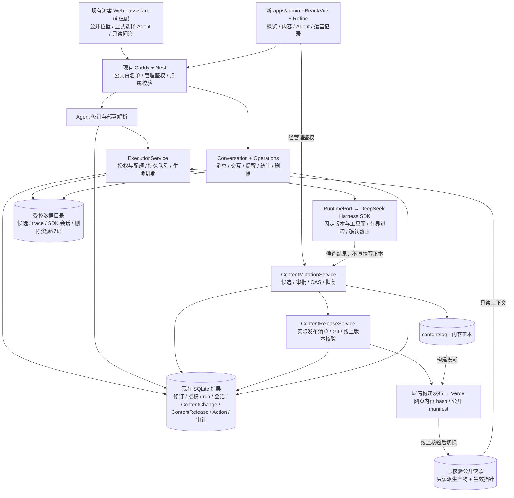
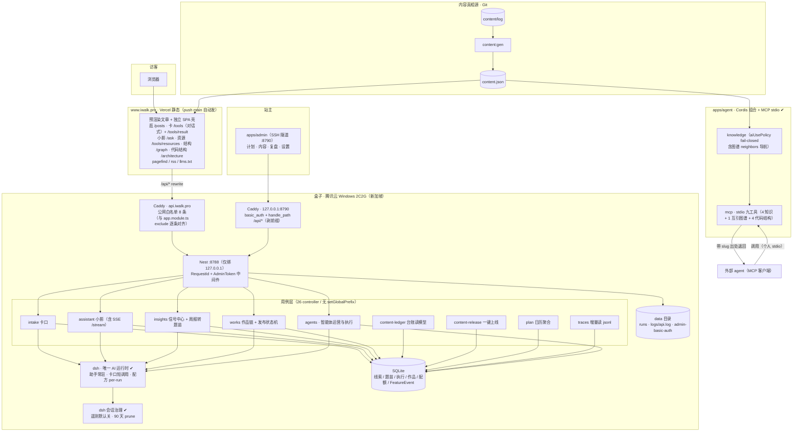
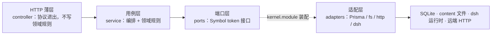
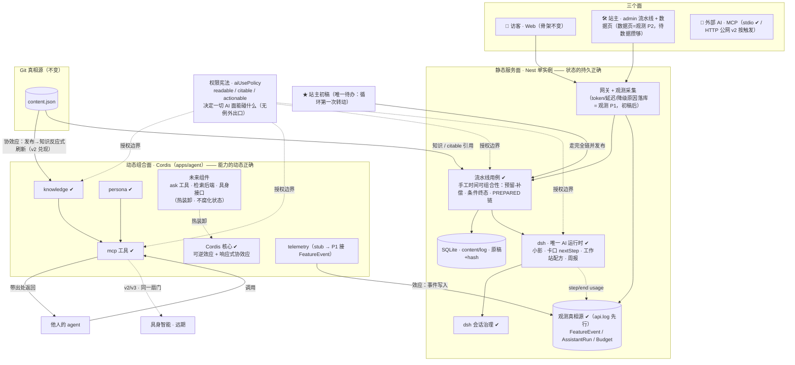
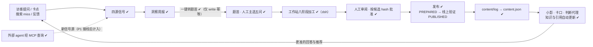

# 架构（权威）：当前态 · 最终态 · 演进对照

> **2026-10-30 图面刷新（G07 生产上线与 admin 云端常驻）**：`output/archify/adgaiwalker-architecture.json` / `.html` 已重出至 HEAD `a88f629`，四门全绿并通过视觉真审。图面事实：①站主工作台由本地运行更新为生产常驻 `admin.iwalk.pro`（经 Caddy 静态托管与鉴权双防线）；②SQLite 27 条迁移全部在生产无损应用；③C01–C24 与 O01–O10 闭环全部上线；④公共位置 readiness 仍阻断模型问答启用，生产模型启用待 G08 核验。

> **2026-10-12 目标拓扑：盒子退场、本机直供（未实施）**：站主指令去掉腾讯云盒子，AI 与 API 由本机直接提供。目标图另存为 `output/archify/adgaiwalker-architecture-local.json` / `.html`（revision 钉 85b597b，四门全绿 + visual-check 通过并已人工看图）；**当前态图 `output/archify/adgaiwalker-architecture.json` 不替换**，因为盒子尚未退场。图上把出口 / Nest / dsh / admin / SQLite / data 六个节点收进「本机 · Mac」边界，Vercel 静态面不动；卡片写明退场清单、必须先起本机再停盒子的顺序、以及三条已知后果：公网白名单退场后只剩 Nest 一侧（`public-route-boundary.test.ts` 的 `compareCaddyPublicRoutes` 契约要重定义）、本机必须 24×7 否则动态功能全停、`resourceHeadroom` 512MB 门禁口径是 2C2G 盒子而非本机。仓库内没有语音/麦克风实现，该项属新增能力，不入图。

> **2026-10-12 本地运行监控面，未部署**：新增进程内观测面（不落库、不引外部监控栈、不新增主工作面）。采集两条：①`app.useLogger` 的 tee 把 Nest Logger 输出同时送终端与 800 行环形缓冲（频道 task/chat/sys，单行 2KB 截断）；②`RequestIdMiddleware` 在原有结构化请求行之外，把同一次请求登记进 200 条指标缓冲（completed/failed/interrupted/inFlight/耗时），路径口径从 `req.url` 改为路由模板。查询面是 `GET /ops/runtime/{metrics,requests,logs}`（管理鉴权内）。规则唯一来源 `packages/shared/src/runtime-monitor.ts`；采集 **fail-open**，与后台日志的 **fail-closed** 语义相反；API 启动失败/进程崩溃时本观测面天然看不到，终端仍是唯一现场。

> **2026-10-12 图面刷新（运行监控）**：运行监控面已重出至 `output/archify/adgaiwalker-architecture.json`（revision 钉 85b597b）并四门全绿、visual-check 通过（视觉已真看图）。它**刻意不单列节点**——跑在 Nest 进程内、不落库、不独立部署、不新增主工作面，单列会让 Caddy→token 那条边穿过构图；事实折进 `nest` 副标「进程内运行监控」与第五张卡片。该能力自身的文件（采集接线 / 端口 / 控制器 / shared 契约）尚未提交，图面 `sources` 只能钉在它依赖的既有采集面 `request-id.middleware.ts` 与接线处 `kernel.module.ts`。

> **2026-10-04 生产 Token 面（85b597b）**：盒子 Caddy 新增 `{$WALKER_TOKEN_HOST}` 段，公网只放 `/v1/*`（Bearer）与 `/connect*` 自助页，面板 /status /healthz 永不出口；上游是笔记本经 Tailscale `serve` 回源（透传 upstream Host），刻意用 inline matcher、不参与 Nest 公网路由对等契约。archify 规格已重出至 `output/archify/adgaiwalker-architecture.json`（revision 85b597b，四卡含 Token 面），四门全绿。

> **2026-09-29 本地后台日志与模型继承**：人工触发的管理请求经鉴权后、进入用例前先在 SQLite `AdminRequestLog` 留进行中行，结束后补 HTTP 结果；业务 `AuditRecord` 不混入访问日志。Agent 未指定提供方时，运行和发布测试均解析 dsh 共享默认提供方与模型。生产拓扑不变，尚未部署。

> **2026-09-29 本地写入边界修复**：访客会话转事项经内部 `ConversationActionCommitPort` 接到 Prisma 适配器，在同一 SQLite 事务写 Action 和 `conversation.convert` 审计；`AuditRecord(action,targetType,requestId)` 唯一索引作为并发同键最终约束。会话证据仍为软引用，前台 AI 写权限不变，生产拓扑未变。

> **2026-09-28 首页小影本地链路**：`XiaoyingHome → GET /assistant/placements/home-xiaoying/site-public → POST /assistant/stream → PublicAssistantService → AgentExecutionService → dsh`。公开上下文来自同一已核验快照，`placementContentAvailable` 与对象权限共同限定全站只读内容；`ConversationSdkSession` 仍保存业务会话与修订绑定。API 重启后运行时不复用未在本进程确认的旧 SDK 会话，改用快照完整提示新建，业务时间线不丢失。仅开发库已启用，生产拓扑未变。

> **2026-09-28 本地访客界面调整，未部署**：UI 把旧称“卡／逛”显示为“提问／文章”，路径仍是 `/tools`、`/posts`，入口语义与 API 流程未变；首页仅重排原有卡片。下方 2026-09-14 as-built 图及 archify 图中的旧称仍描述既有生产版本，不表示本地新界面已上线。后台台账现在把 Git 状态、线上确证和问答索引分开读取；最新发布尝试 UNKNOWN 不覆盖上一确证版本。

> **2026-09-27 本地发布链修正，未部署**：API 与手工内容发布脚本使用同一个持久数据目录中的发布锁；API 子进程接续锁持有权，脚本运行结果不明时保持 `UNKNOWN` 与锁的退出证明。管理端执行发布需引用已批准的 `ContentRelease`，并在 SQLite 事务内排序授权复检和阶段推进。网页已发布版本从最近一次确证记录读取；具体边界见技术方案 §11.2、根 `to-do.md` 的 G06.R 补检。

> **2026-09-25 本地现状更新**：F01–F18、R01–R33、V01–V24 与 C01–C05 已实现并验收，未部署。R 阶段已把 Agent 试跑和旧后台调用收敛到单槽持久队列；V 阶段已建立核验快照、位置部署与访客准入；C02 已迁移 `ContentChange`/`ContentRelease` 并接入 Kernel 仓储；C03 实现内容文件 CAS；C04 将候选 apply intent/result 与审计同事务持久化，并由 reconcile 依据磁盘 hash 续做、补记或冲突；C05 让现有人工保存通过 AdminToken 鉴权、CAS 和 before/after audit，不再自动生成公共内容快照。候选原文读取、编辑 UI、新发布执行链仍未完成。V21 增加受控筛选快照导出；V22 固定 Nest/Caddy 公网路由和全局 Origin 校验；V23 在启用和公开解析前核对六项 readiness；V24 用隔离库/假 Runtime 完成访客日志闭环。当前 API 未配置真实运行探针报告，readiness 会阻断公共位置启用。下一项 C06；生产恢复/部署与新发布链仍待后续批次，生产 Caddy 运行态留 G08 核验。

### 新框架本地已接通链路

`GET /ops/capabilities` 检查实际读用例；`GET /ops/agents` 不调用自动创建默认角色的旧列表用例；`GET /ops/runs` 和详情仅读同一历史表。Agent 修订、试跑与部署管理已接入；访客问答从 V10 起使用统一执行队列。消息历史、交付确认、文章页入口和写入发布仍未接入。进度只在根 `to-do.md` 维护，[框架验收证据](evidence/ADMIN-FRAMEWORK-ACCEPTANCE.md)。

## 新后台目标拓扑（2026-09-22，提案）

来源：[PRD](specs/PRD-AGENT-OPERATIONS.md)、[开源调研](specs/RESEARCH-AGENT-OPS-OPEN-SOURCE.md)、[技术方案](specs/TECH-DESIGN-AGENT-OPERATIONS.md)。以下是目标拓扑，**部分本地实现，尚未部署**；下文历史图中后台页面与“唯一运行时已完成”标记不能用于判断此次重构状态。当前本地后台已接入框架、Agent 修订/运行/部署、只读公共问答、文章访客与日志闭环，以及 C02 候选/发布持久表与仓储、C03 文件 CAS、C04 内部候选 apply/reconcile 恢复、C05 人工保存 CAS 与审计；候选原文仓储、编辑 UI、新发布服务仍待实施。

边界：所有业务请求经过网关；图中 admin→内容变更箭头表示鉴权后的应用调用。前台 origin 上限不可升级；模型不直接操作正本或 Git。DB 保存业务事实、trace 保存诊断，不互相冒充。公开问答只读取已核验快照，工作区生成物不能提前对外生效；网页构建将公开清单发布在 `/public-manifest.json`，快照导入须与这个线上构建清单的集合 hash 一致。保留单 Nest/SQLite，默认一个模型槽；双槽验证后才开，不部署 Paperclip 或 Langfuse 后端。详细状态机、数据增量、API 与迁移规则仅在配套技术方案维护。

> **2026-09-21 后台重构状态（优先于下文旧界面说明）**：站主要求清空管理界面。`apps/admin` 仅保留空白开发/构建入口与 API 代理；计划、内容、复盘、设置、旧路由及管理 UI 均已退役。API、数据库、文章与共享规则保留，生产未部署此变更。旧后台页面图与验收记录仅作历史参考，不作为新重构需求。资产清单见 [后台重构前资产清单](evidence/ADMIN-REBUILD-INVENTORY.md)。

> 本文件是全项目架构的唯一权威图面；边界规则原文在 [`PLAN.md`](../PLAN.md) §2（五条宪法同在彼处）。
> 更新纪律：拓扑/组件/数据流变更须回写本文件；图中状态标注随部署实况更新。
> 基准：2026-09-14 · 本地工作区 as-built（生产基线：2026-09-03 切流 + 2026-09-09 智能体工坊上线）。

## 一、当前架构（as-built 2026-09-14）

### 1.1 运行拓扑（部署视角）

**接入约定（勿踩）**：`api/` 前缀由接入侧补——生产 Caddy `handle_path /api/*` 与开发期 vite `rewrite` 都会剥掉 `/api` 再转发，因此 **controller 一律不自带 `api/` 前缀**（health 走 `/health`，其余走 `/clues`、`/agents`…）。公网白名单是双侧同步：`apps/api/src/app.module.ts` 的 exclude 表 + `ops/windows/Caddyfile`，漏一侧即 401/404。

### 1.2 代码分层（依赖方向）

- **依赖方向**：controller → service → port ← adapter；新增能力先定 port 再写 adapter，接线只在 `kernel.module.ts`。
- **Nest DI**：接口 token 必须显式 `@Inject(TOKEN)`（`tsx` 下无 `emitDecoratorMetadata`，裸类型参数会注入成 `undefined`）。
- **AI 双实现**：AI 策略（`AiNextStepAdapter` / `HarnessAssistantAdapter`）与规则兜底（`RuleNextStepAdapter` / `RuleAssistantAdapter`）同在适配层；**站主面（`DshAgentRunner` 配方）无兜底，失败如实抛错**。
- **内容真相源唯一**：`content/log` →（`scripts/generate-content.ts`）→ `apps/web/src/generated/content.json`，被 web 打包、api 内容索引、agent 知识库、预渲染与 feeds 共同消费。
- **管理端（2026-09-17）**：工作面计划 / 内容 / 复盘；底部设置（Agent / 观测 / 结构）。系统折叠抽屉已废除。题苗、执行仅深链。流水线、工作台重定向到计划。
- **轨迹层**：`data/runs/<runId>/trace.jsonl` 是运行事实唯一真相源；DB 的 AgentRun / SkillRun / AssistantRun 只做索引。读取走 `after=<seq>` 增量，禁止全量解析进前端。发布与 Agent 共用同一个时间线渲染器。

## 二、最终架构（定稿 · 2026-09-06 论文修订版）

## 三、循环飞轮（最终架构的心脏）

**循环状态：全链每一环都已建成并通过测试/生产验证——只差第一次真实转动（★站主初稿）。**

## 四、边界规则与不变式（原文见 PLAN §1/§2）

- **两面**：静态服务面（Nest·状态的持久正确：预留-补偿/条件终态/PREPARED 链）｜动态组合面（Cordis·能力的动态正确：可逆效应+反应式协效应）。
- **三层中心规则**：进程内去中心（组件平等）；机器间中心（一盒一份真相源）；访问层去中心（Web/llms.txt/MCP 开放协议）。
- **骨架不换**：现有服务迁移 Cordis 已否决；Cordis 只以 `apps/agent` 新建组合进入。
- **权限宪法不可绕过**：`aiUsePolicy`（readable / citable / actionable）是所有 AI 面（小影、卡口、判断代理、远期具身）的唯一授权来源；判断的定价权在人（主选/审批/发布永远是站主点击），AI 只起草和建议。

## 五、演进对照（当前 → 最终）

| 组件 | 状态 |
|---|---|
| AI 运行时统一（dsh 四用例） | ✔ 生产（小影/卡口 AI 实测真答；配方可用） |
| 卡口/工作站 codex 退役 | ✔ |
| 观测 P0（遥测关闭/会话治理/api.log） | ✔ 生产 |
| 共创显性化 + 周报转题苗 | ✔ 生产（本批） |
| admin 流水线默认首页 | ✔ 生产（本批） |
| 智能体工坊（agents + 文件直调；2026-09-23 R25c 模型提供方改由 dsh 原生管理） | ✔ 本地已完成 R25c 升级，旧自建提供方表与 AES 密钥已退役 |
| 卡口形态：向导 → 对话式 | ✔ 本地（`/tools` 一问一答 + `/tools/result` 深链，noindex） |
| 判断代理 v1（Cordis+MCP stdio） | ✔ 脚手架（A0–A3；A4 stub；A5 dogfooding 待站主） |
| **知识图谱**（访客 `/graph` + 文章页局部图 + 站主结构体检 + MCP `neighbors`） | ✔ 建成（2026-09-14；待盒子部署 + 线上验证） |
| **代码架构图谱**（门禁 `verify:architecture` + 访客 `/architecture` + admin 体检 + MCP 四工具） | ✔ 建成（2026-09-15；同一引擎的第二个领域，见 §六） |
| 观测 P1（token/延迟/降级原因落库） | 待初稿后 |
| 数据页三标签（观测 P2） | 待数据攒够 |
| 判断代理 v2（HTTP 公网/ask/反向挂载） | 按触发 |
| ★ 站主初稿全链 | **唯一待办（人）** |
| 具身 | 远期（同一 MCP 接口消费） |

## 六、代码图（增补：结构事实，**不是**架构权威）

> 本节是**增补**，不改本文件作为「唯一架构图面」的地位。
> 上面的图与表说的仍是**意图与拓扑**（为什么这样分层）；本节说的是**结构事实**
> （用编译器语法树抽出来的真实 import）。二者冲突时：**架构以本文件为准，事实以抽取结果为准**，
> 冲突本身就是值得知道的信息（说明声明与代码已经漂移）。

| 项 | 内容 |
|---|---|
| 抽取实现（唯一） | `scripts/lib/code-extract.ts`（解析规则在 `packages/shared/src/code-resolve.ts`，语法抽取在 `code-imports.ts`） |
| 产物（公开面） | `apps/web/src/generated/codegraph.json` —— 只有节点与边，被 `/architecture` 动态引入 |
| 产物（内部面） | `apps/web/src/generated/codegraph-health.json` —— 体检明细，只有门禁 / api / admin / agent 读 |
| 门禁 | `pnpm verify:architecture`（`build:web` 链上，紧随 `code:gen`）；硬伤新增即失败，基线在 `scripts/architecture-baseline.json` |
| 消费方 | 访客 `/architecture`（indexable）· admin `/architecture`（noindex）· MCP `dependencies`/`dependents`/`impact`/`architecture_health` |
| 规格与偏离 | [`PRD-CODE-GRAPH.md`](specs/PRD-CODE-GRAPH.md) |

**规模实测（2026-09-15）**：430 个源文件 / 1101 条内部依赖边 / 0 个环 / 1 个解析不到的引用 /
2 个从入口不可达的文件 / 0 个反向依赖；风格项：6 个超大文件、10 个超级枢纽（最大是 `apps/api/src/kernel.module.ts`，107 度）。

### Agent 基础本地接线（2026-09-22）

Admin → `/ops/agents` → AgentCatalogService → AgentRevisionRepository → SQLite；修订与审计同事务。Admin → `/ops/grants` → AuthorizationService → OperationsJournal → grant + audit 同事务。AgentExecutionService.preflight → revision / grant / ExecutionObjectPolicy → shared 策略交集；当前没有接运行调度。ExecutionRun 持久保存资源范围，父子范围只收窄。OutboxDispatcher 仅处理注册的数据库事务消费者，未配置业务派发时钟。真实运行、部署与内容写入仍由后续批次接通，见 [验收边界](evidence/AGENT-CORE-ACCEPTANCE.md)。
