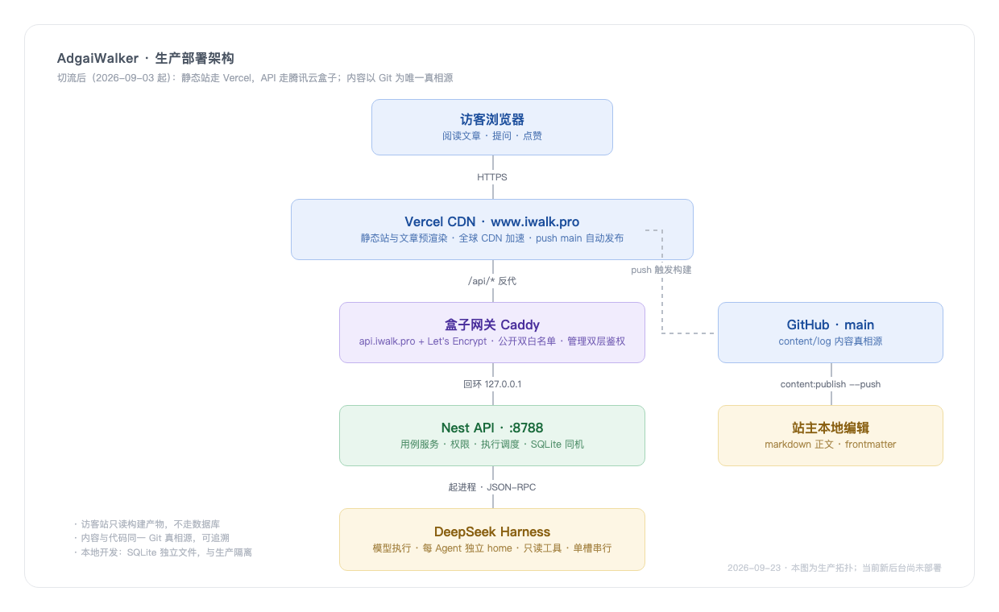
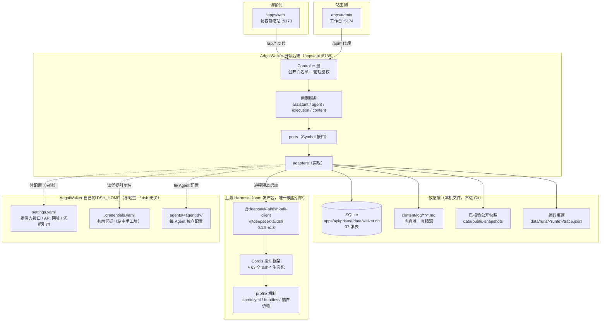
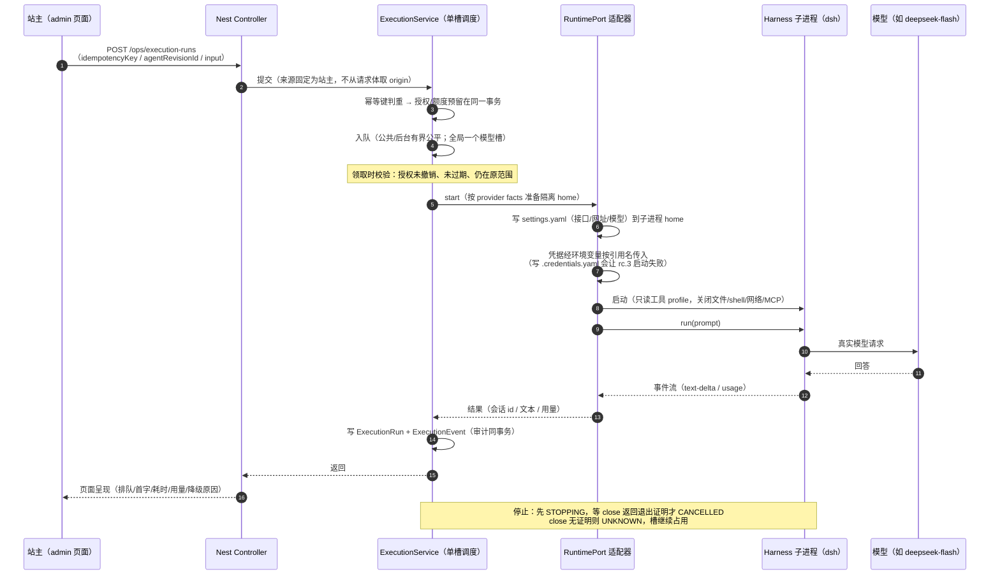
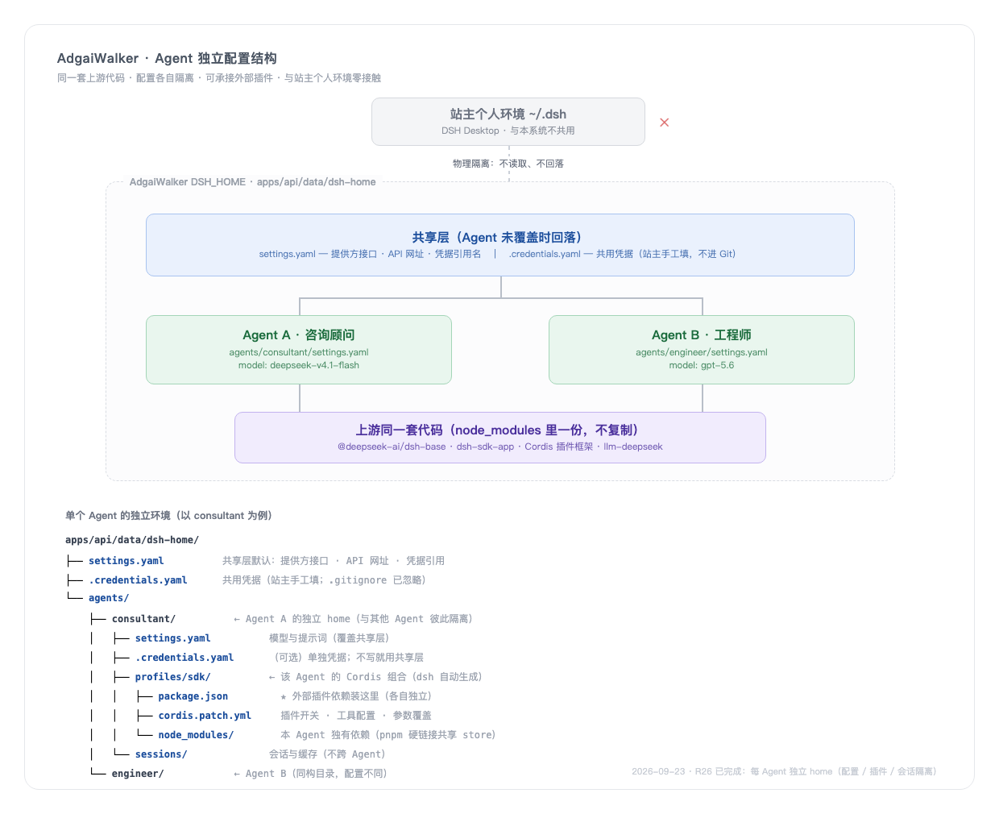
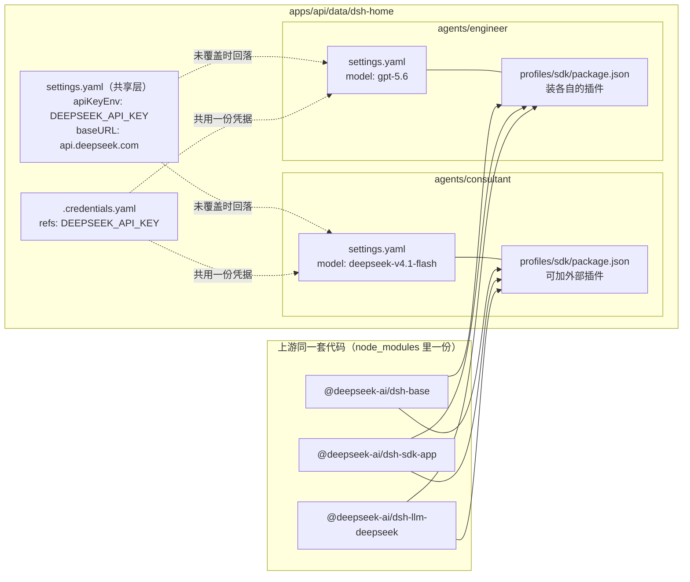
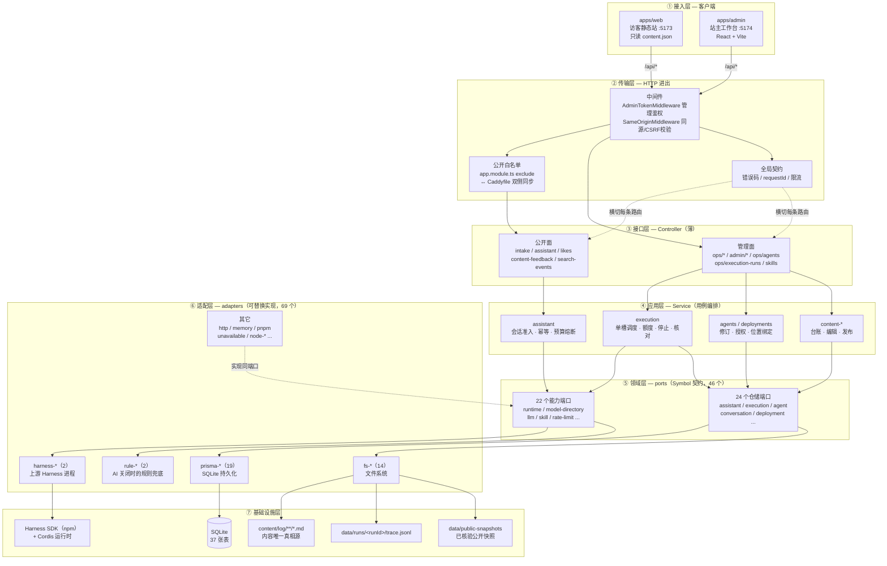
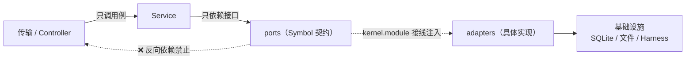
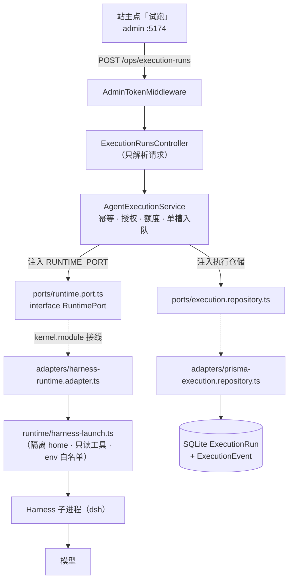
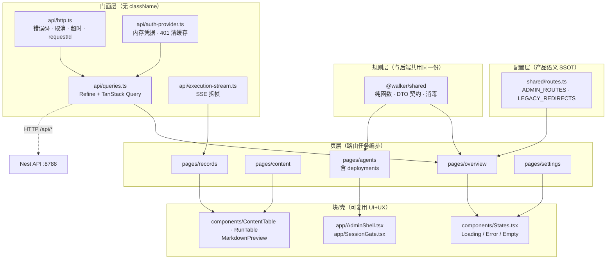
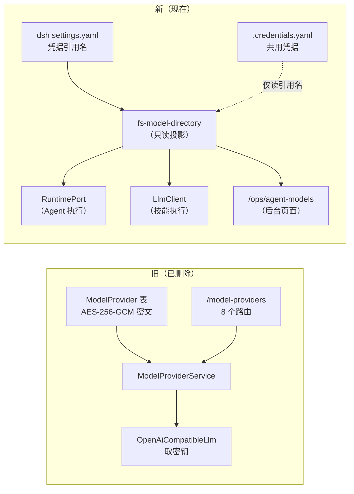

# Agent 运行时架构（2026-09-23 实况）

> 本文只描述**已经落地并有验证证据**的结构。依据：R21 真实探针通过（`docs/evidence/runtime-probe.json`）、
> R25a–c 提供方改用 dsh 原生管理、R27 SDK 统一为 npm 发布包。
> 相关设计文档：`docs/TECH-DESIGN-AGENT-OPERATIONS.md`、`docs/PRD-AGENT-OPERATIONS.md`。

## 0. 一句话

**AdgaiWalker 自有后端 + 自有数据 + 上游 Harness SDK（npm 发布包）作为唯一模型执行引擎；
站主个人环境（`~/.dsh`、DSH Desktop）与本系统零接触。**

---

## 0.1 部署架构（生产总览图）

> 图源：[`docs/assets/deploy-architecture.html`](../assets/deploy-architecture.html)（改文字后重新截图即可）

**两条链**：

| 链 | 路径 | 特点 |
|---|---|---|
| **访客请求链**（居中主链） | 访客浏览器 → Vercel CDN → 盒子网关 Caddy → Nest API :8788 → DeepSeek Harness | 静态资源由 Vercel 直供；只有 `/api/*` 回到盒子 |
| **内容发布链**（右侧） | 站主本地编辑 → `content:publish --push` → GitHub main → 触发 Vercel 构建 | **内容只走 Git**，不进数据库；全链可追溯 |

**关键边界**：盒子只监听回环（`127.0.0.1:8788`），公网入口只有 Caddy；
公开路由白名单在 `app.module.ts` 与 `Caddyfile` **双侧同步**，漏一侧即 401/404。

---

## 1. 总体拓扑

**要点**

- **模型执行只有一条路**：全部经 `ports/runtime.port.ts` → Harness SDK。没有第二条直连通道（技能用的
  `LlmClient` 也从同一份 dsh 目录取提供方与凭据）。
- **自有后端不管模型实现细节**：它只准备「提供方事实 + 凭据引用 + 只读工具策略」，交给上游 runtime。
- **两个 DSH_HOME 物理隔离**：站主个人环境在 `~/.dsh`，本系统在 `apps/api/data/dsh-home`。
  代码里 `resolveModelHomeDir()` **不回落** `~/.dsh`——这是 R26/R27 立的规矩，有测试锁住。

---

## 2. 一次 Agent 执行的时序（后台试跑 / 统一执行）

**要点**

- **单槽串行**（R12）：全局一个模型槽，一次只跑一个调用；这是 2C2G 盒子上的资源纪律。
- **停止是两阶段**（R13）：页面点停止 ≠ 进程已停；必须拿到退出证明才释放槽。
- **幂等**：`idempotencyKey` 重复提交返回同一运行，不重复扣额度。

---

## 3. 配置隔离结构（同一套代码 + 各自配置）

> 图源：[`docs/assets/agent-config-structure.html`](../assets/agent-config-structure.html)

**三层关系**：

| 层 | 位置 | 作用 |
|---|---|---|
| **站主个人环境** | `~/.dsh` | **不读、不回落**（图中 ✕）；产品配置不得绑到站主个人环境 |
| **共享层** | `dsh-home/settings.yaml` + `.credentials.yaml` | Agent 未覆盖时回落；凭据默认共用一份 |
| **Agent 层** | `dsh-home/agents/<agentId>/` | 各自独立 home：模型、提示词、插件、会话互不串 |

**每个 Agent 的 `profiles/sdk/` 就是它的 Cordis 组合**（与 dsh 同款框架、上游自动生成）：
`package.json` 装**该 Agent 独有**的外部插件，`cordis.patch.yml` 管插件开关与参数覆盖。
装插件走上游原生命令，不自己实现插件系统。

**同一套代码**：所有 Agent 共享 `node_modules` 里同一份 `@deepseek-ai/dsh-base` 等 bundle
（图中紫色块），不复制代码；各自 `node_modules/` 通过 pnpm 硬链接共享 store，磁盘不成倍增长。

**要点**

- **同一套代码**：两个 Agent 共享上游同一个 bundle（不复制代码）。
- **配置隔离**：模型、系统提示词、插件各写各的。
- **凭据默认共用**（站主决定），但每个 Agent 可单独指定自己的引用名（`apiKeyEnv`）。
- **外部插件**：装在各自 profile 的 `package.json`，互不影响。

> **状态（2026-09-23 R26 已完成）**：`resolveSessionHome` 支持 agentId、`syncProviderHome` 改保留式合并、
> `RuntimeOwner.agentId` 打通执行链路（零迁移）、adapter 按 Agent 切换实例、站内助手小影同样用 `agents/xiaoying/`。
> 每个 Agent 的 `profiles/sdk/`（含外部插件依赖）由 dsh 在该 home 内自动生成；
> **首次启动会初始化 profile（装依赖，较慢）**，之后常驻复用。

---

## 4. 分层架构（六边形 / Ports & Adapters）

### 4.1 全栈分层总览

### 4.2 依赖方向（硬规则）

**四条禁止**（review 时逐条核）：
1. Controller 直接调 adapters —— 绕过用例，规则失守
2. Service 直接用 prisma 客户端 —— 端口形同虚设
3. ports 反向 import adapters —— 契约被实现绑死
4. adapters import Controller —— 依赖倒挂

| 层 | 可以有 | 不可以有 |
|---|---|---|
| **Controller** | 解析请求、调 Service、组响应 | 领域规则、直接读库、直接起进程 |
| **Service** | 编排、业务规则、事务边界 | `new PrismaClient()`、`fs` 直读、spawn 进程 |
| **ports** | `interface` + Symbol token | 任何 import 具体实现、import React |
| **adapters** | 实现端口、碰外部系统 | 被 Service 直接 import（只经 token 注入） |
| **shared** | 纯函数、契约、DTO | React、Nest 装饰器、fs、网络 |

### 4.3 一个具体例子：模型执行如何穿过各层

**换实现只动一层**：
- 换模型引擎 → 只改 `adapters/harness-*.ts` + kernel 一行接线
- 换配置来源 → 只改 `adapters/fs-model-directory.ts`
- 换数据库 → 只改 `adapters/prisma-*.ts`

### 4.4 前端分层（admin）

**分层纪律**（与后端同构，越界即 review 打回）：

| 层 | 可以有 | 不可以有 |
|---|---|---|
| 配置 | `routes.ts` 的路径常量 | 组件、请求 |
| 规则 | `@walker/shared` 纯函数 | `import React`、`fetch`、`fs` |
| 门面 | HTTP 调用、错误归一、缓存 | `className`、JSX |
| 页 | 调门面、组合块、路由参数 | 复制第二套校验、直连 fetch |
| 块/壳 | `props + onXxx`、布局 | 领域规则、intake/主选业务 |

---

## 5. 环境隔离边界（硬规则）

| 边界 | 规则 | 依据 |
|---|---|---|
| 站主个人环境 | 代码**不读** `~/.dsh`、不读 `DSH_HOME`；只读 `WALKER_MODEL_HOME` 或 `apps/api/data/dsh-home` | R26/R27，有测试锁住 |
| 子进程环境 | 白名单变量 + **凭据值经环境变量按引用名传入**；写 `.credentials.yaml` 会让 rc.3 启动失败 | R10 实测 |
| 工具权限 | 只读：关闭文件/shell/网络/MCP，沙箱 `read-only` | R10，探针验证 |
| 后台/前台会话 | 目录分开（`.dsh-admin` / `.dsh-assistant`），会话不可跨受众复用 | R10/V08 |
| 密钥 | 不进 Git、不进日志、不进接口响应（目录只暴露**引用名**与有无） | R25a/c |
| SDK 来源 | 只用 npm 发布包（GitHub 官方产物），不用本地 clone | R27 |

---

## 6. 与"旧体系"的区别（已删除的东西）

- 删除了 `ModelProvider` / `Credential` 表（迁移 `20260923110000_...`）、AES 加密模块、8 个 `/model-providers` 路由。
- 提供方与凭据现在**只有一份真相源**：dsh 原生设置。
- 附带修正：`AgentUnit.providerId` 指向本地表的外键已移除（否则无法写 dsh 路由名）。
